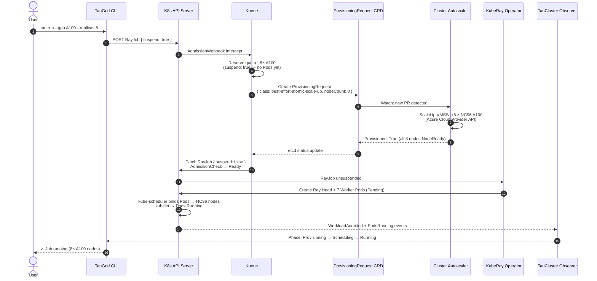
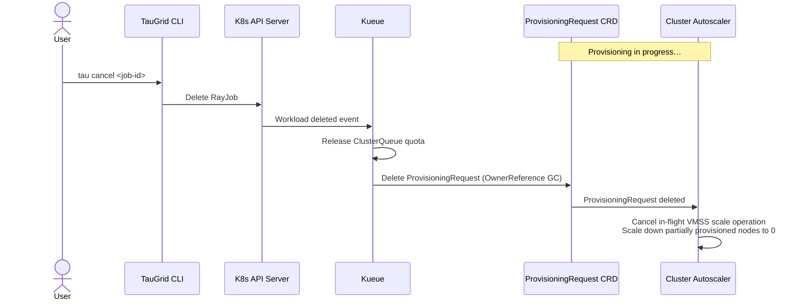
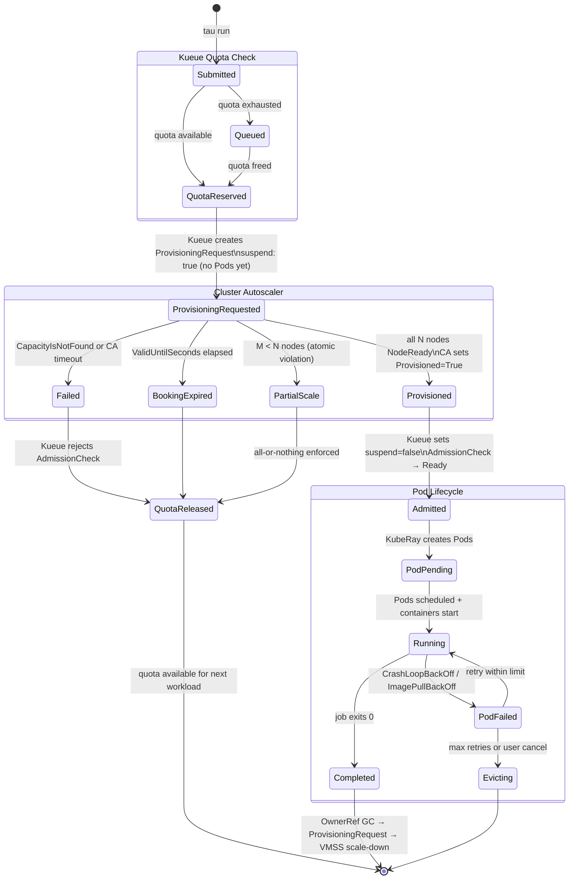
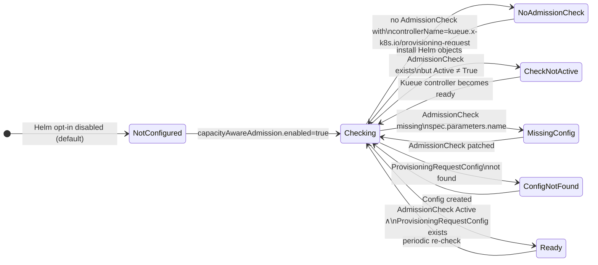

# Capacity-Aware Kueue Admission with Cluster Autoscaler

**Status:** Implementation — `feat/capacity-aware-kueue-admission`
**Issue:** [#278](https://github.com/Azure/taugrid/issues/278)
**Scope:** Single-cluster (v1)

## Problem

Kueue today admits a workload once logical quota is available. Pods remain
`Pending` while Cluster Autoscaler provisions GPU nodes. Researchers cannot
distinguish queue wait from scale-up wait from capacity that will never appear.
A partial scale-up can leave a Ray head node running without its workers,
holding reserved quota indefinitely.

## Goal

Make Kueue wait for CA to confirm actual node provisioning **before**
unsuspending the workload, with atomic (all-or-nothing) gang semantics at the
node level.

---

## Key Decisions

| # | Decision | Rationale |
|---|----------|-----------|
| D1 | Reuse Kueue's ProvisioningRequest AdmissionCheck (`kueue.x-k8s.io/provisioning-request`). TauGrid does not create ProvisioningRequest objects. | Avoids a duplicate controller and stays aligned with upstream Kueue. |
| D2 | No new `tau.yaml` fields in v1. Capacity-aware admission is a platform queue/flavor property. | Keeps the researcher API stable. |
| D3 | No new `executionTarget`. It stays `singleCluster`. | Provisioning is transparent to workload profiles. |
| D4 | MultiKueue and ProvisioningRequest are mutually exclusive on one ClusterQueue. | Kueue enforces this; a ClusterQueue cannot use both admission check controllers. |
| D5 | Helm defaults stay quota-only. Platform engineers opt in via `capacityAwareAdmission.enabled=true`. | Safe default for existing installs. |
| D6 | First AKS provisioning class: `best-effort-atomic-scale-up.autoscaling.x-k8s.io`. The `check-capacity` class only tests existing nodes and cannot scale from zero. | Only `best-effort-atomic-scale-up` triggers VMSS scale-up. |

---

## Architecture

```
┌──────────────────────────────────────────────────────────────────┐
│ TauGrid                                                          │
│  CLI: tau run → RayJob (suspend: true)                          │
│  TauCluster Observer: watches WorkloadAdmitted + PodsRunning     │
│  ProvisioningReady condition: wiring health of AdmissionCheck    │
└──────────────────────┬───────────────────────────────────────────┘
                       │ POST RayJob
┌──────────────────────▼───────────────────────────────────────────┐
│ K8s API Server / Kueue                                           │
│  1. Reserve ClusterQueue quota          (suspend: true)          │
│  2. Create ProvisioningRequest CRD      (autoscaling.x-k8s.io)  │
│  3. Watch ProvisioningRequest status                             │
│  4. Set suspend: false when Provisioned=True                     │
└──────────────────────┬───────────────────────────────────────────┘
                       │ Watch ProvisioningRequest
┌──────────────────────▼───────────────────────────────────────────┐
│ Cluster Autoscaler (AKS managed)                                 │
│  5. Call Azure VMSS API to provision GPU VMs                     │
│  6. Set Provisioned=True when all N nodes are NodeReady          │
│  7. Set Failed / BookingExpired on timeout                       │
└──────────────────────────────────────────────────────────────────┘
```

## Provisioning Timeout

Kueue reserves quota before it asks Cluster Autoscaler for capacity, and has no
deadline for the answer. On AKS the autoscaler does not fail a request it cannot
satisfy, so without a deadline the quota is held indefinitely.

`ProvisioningTimeoutReconciler` in tau-core-controller supplies the deadline. It
watches Kueue Workloads and acts on one only when all of these hold:

- `spec.active` is not `false`
- `QuotaReserved=True`, and neither `Admitted` nor `Finished` is true
- an admission check whose AdmissionCheck has
  `controllerName: kueue.x-k8s.io/provisioning-request` is in state `Pending`
- the `QuotaReserved` condition is older than the timeout

It then sets `spec.active=false` and records a `ProvisioningTimeout` warning
event on the Workload. Kueue does the rest: evicts the Workload, deletes its
ProvisioningRequest and releases the quota. No pod was ever created.

The timeout is off by default. Enable it with the controller flag
`--provisioning-timeout=<duration>`, or in Helm:

```yaml
tau-core-controller:
  provisioningTimeout: 30m
```

This is the one place TauGrid writes to a Kueue Workload for this feature. It
still does not create or modify ProvisioningRequests (decision D1).

## Component Ownership

| Component | Responsibility |
|-----------|----------------|
| TauGrid CLI | Renders `suspend: true` workloads with ClusterQueue label |
| TauCluster controller | Observes ProvisioningReady condition; does **not** reconcile ProvisioningRequests |
| Provisioning timeout controller | Optional. Deactivates a Workload that has held quota past the timeout while its provisioning check is `Pending` |
| Kueue | Reserves quota, creates ProvisioningRequest, sets `suspend: false` on success, releases quota on failure |
| Cluster Autoscaler | Watches ProvisioningRequest CRD; triggers VMSS scale-up; sets `Provisioned: True` or `Failed` |
| Platform engineer | Enables autoscaling on GPU node pool; installs Helm opt-in objects; applies ClusterQueue patch |

---

## 10-Step Workload Lifecycle

```
 1. [CLI]        tau run → TauGrid renders RayJob with suspend: true
 2. [K8s API]    RayJob submitted → Kueue admission webhook
 3. [Kueue]      ClusterQueue quota reserved — no Pods yet
 4. [Kueue]      ProvisioningRequest created (best-effort-atomic-scale-up, 8× NC96)
 5. [CA]         VMSS scale-up triggered via Azure Cloud Provider API
 6. [CA]         All 8 nodes NodeReady → Provisioned: True on ProvisioningRequest
 7. [Kueue]      AdmissionCheck → Ready; suspend: false set on RayJob
 8. [KubeRay]    Ray Head + 7 Worker Pods created (Pending)
 9. [Scheduler]  Pods bound to NC96 nodes via nodeAffinity (agentpool label)
10. [TauGrid]    Observer streams: Capacity Provisioning → Pod Scheduling → Running
```

### Sequence Diagram — Happy Path



### Sequence Diagram — Cancellation During Scale-Up



---

## New Status Phase

`tau run status --watch` gains a new phase:

```
Queued → Capacity Provisioning → Pod Scheduling → Running
```

If the provisioning check is **Rejected**, `--watch` fails immediately rather
than hanging. A new `ProvisioningReady` condition on `TauCluster` reflects the
platform-level wiring health and fails closed for affected profiles.

---

## Implementation

### New files

| File | Purpose |
|------|---------|
| `controllers/tau-core/internal/controller/provisioning_ready.go` | `ProvisioningReadinessReader` interface and `KubernetesProvisioningReadiness` observer |
| `charts/taugrid/templates/capacity-aware-admission.yaml` | Helm objects: `ProvisioningRequestConfig`, `AdmissionCheck`, `ResourceFlavor` |

### Modified files

| File | Change |
|------|--------|
| `controllers/tau-core/api/v1alpha1/types.go` | Add `ConditionProvisioningReady = "ProvisioningReady"` |
| `controllers/tau-core/internal/controller/cluster_controller.go` | Add `ProvisioningReadiness` field; call observer; watch `AdmissionCheck`; include condition in status |
| `charts/taugrid/values.yaml` | Add `capacityAwareAdmission` section (disabled by default) |

### Wiring in `main.go` (required when enabling)

```go
if cfg.CapacityAwareAdmissionEnabled {
    reconciler.ProvisioningReadiness = &controller.KubernetesProvisioningReadiness{
        Reader: mgr.GetAPIReader(),
    }
}
```

---

## Kubernetes Manifest Examples

### ProvisioningRequestConfig

```yaml
apiVersion: kueue.x-k8s.io/v1beta2
kind: ProvisioningRequestConfig
metadata:
  name: taugrid-provisioning-request-config
spec:
  provisioningClassName: best-effort-atomic-scale-up.autoscaling.x-k8s.io
  managedResources:
  - nvidia.com/gpu
  parameters:
    ValidUntilSeconds: "600"
  retryStrategy:
    backoffLimitCount: 3
    backoffBaseSeconds: 60
    backoffMaxSeconds: 1800
```

### AdmissionCheck

```yaml
apiVersion: kueue.x-k8s.io/v1beta2
kind: AdmissionCheck
metadata:
  name: taugrid-provisioning-admission-check
spec:
  controllerName: kueue.x-k8s.io/provisioning-request
  parameters:
    apiGroup: kueue.x-k8s.io
    kind: ProvisioningRequestConfig
    name: taugrid-provisioning-request-config
```

### ResourceFlavor (scale-from-zero GPU)

```yaml
apiVersion: kueue.x-k8s.io/v1beta2
kind: ResourceFlavor
metadata:
  name: taugrid-gpu-scale-from-zero
spec:
  nodeLabels:
    kubernetes.azure.com/agentpool: gpupool
    node.kubernetes.io/instance-type: Standard_NC96ads_A100_v4
  tolerations:
  - key: sku
    value: gpu
    operator: Equal
    effect: NoSchedule
```

### ClusterQueue patch (cluster-overlays)

```yaml
apiVersion: kueue.x-k8s.io/v1beta2
kind: ClusterQueue
metadata:
  name: cluster-queue
spec:
  admissionChecksStrategy:
    admissionChecks:
    - name: taugrid-provisioning-admission-check
      onFlavors:
      - taugrid-gpu-scale-from-zero   # scoped to GPU flavor only
```

### Sample RayJob

```yaml
apiVersion: ray.io/v1
kind: RayJob
metadata:
  name: llm-finetuning
  namespace: tau-user-workspace
  labels:
    kueue.x-k8s.io/queue-name: jobqueue
spec:
  suspend: true   # TauGrid always sets this
  entrypoint: "python train.py"
  rayClusterSpec:
    headGroupSpec:
      rayStartParams:
        num-cpus: "0"
      template:
        spec:
          containers:
          - name: ray-head
            image: rayproject/ray:2.40.0-py311-gpu
    workerGroupSpecs:
    - groupName: gpu-workers
      replicas: 8
      rayStartParams:
        num-gpus: "4"
      template:
        spec:
          tolerations:
          - key: sku
            value: gpu
            operator: Equal
            effect: NoSchedule
          containers:
          - name: ray-worker
            image: rayproject/ray:2.40.0-py311-gpu
            resources:
              requests:
                nvidia.com/gpu: "4"
              limits:
                nvidia.com/gpu: "4"
```

---

## State Machine

### Workload Lifecycle States



### ProvisioningReady Condition on TauCluster



---

## Failure Modes

Rows marked observed were exercised by the test matrix in
[`examples/README.md`](examples/README.md). The others are expected behaviour
that has not been tested.

| Scenario | Trigger | Resolution |
|----------|---------|------------|
| Capacity not available (observed on AKS) | CA sets `Provisioned=False` / `CapacityIsNotFound` and keeps retrying; it does not set `Failed`. No change in a 21-minute watch | Without the timeout: check stays `Pending`, quota stays reserved, later jobs starve. With `--provisioning-timeout` (observed): the controller deactivates the Workload once it has held quota that long; Kueue evicts it, deletes the ProvisioningRequest and releases the quota. The Job stays suspended and is not retried |
| Capacity request failed (observed, failure simulated) | CA sets `Failed=True` | Check goes to `Retry`; quota is released after the retry backoff (60s by default) and the workload is requeued, up to `retryLimit` times before the check is rejected |
| Booking expiry | `ValidUntilSeconds` elapsed, `Provisioned: True` not set | Same as Failed; Kueue retries up to `retryLimit` |
| Partial scale-up (atomic violation) | Cloud provisions M < N requested nodes | `best-effort-atomic-scale-up` rejects; atomic cancel; quota released |
| ImagePullBackOff / CrashLoopBackOff | Nodes provisioned but runtime fails | TauGrid retry policy; on max retries Workload deleted → OwnerRef GC → CA scale-down |
| User cancellation while waiting | Job deleted while ProvisioningRequest pending | Observed: Workload and ProvisioningRequest are garbage-collected, no pod was created, quota released. Aborting an in-flight VMSS operation was not tested |
| Label mismatch | ResourceFlavor nodeLabels don't match AKS pool labels | Pods stay Pending; fix `gpuFlavor.agentPool` / `instanceType` in Helm values |
| MultiKueue conflict | ClusterQueue has both MultiKueue and provisioning checks | Kueue rejects ClusterQueue config; use separate ClusterQueues |

### Timeout reference

| Parameter | Default | Description |
|-----------|---------|-------------|
| `bookingExpirationSeconds` | 600 | Seconds for CA to set `Provisioned: True` |
| `minBackoffSeconds` | 60 | Initial retry delay after failure (`retryStrategy.backoffBaseSeconds`) |
| `maxBackoffSeconds` | 1800 | Max retry delay (`retryStrategy.backoffMaxSeconds`) |
| `retryLimit` | 3 | Max retries before permanent rejection (`retryStrategy.backoffLimitCount`) |

---

## Enabling (Platform Engineer Runbook)

```bash
# 1. Enable autoscaling on the AKS GPU node pool (min-count=0)
az aks nodepool update \
  --cluster-name <cluster> \
  --resource-group <rg> \
  --name gpupool \
  --enable-cluster-autoscaler \
  --min-count 0 --max-count 8

# 2. Install the ProvisioningRequest CRD. AKS does not ship it, and Kueue
#    disables its provisioning controller at startup when it is missing.
kubectl apply --server-side -f \
  https://raw.githubusercontent.com/kubernetes/autoscaler/master/cluster-autoscaler/apis/config/crd/autoscaling.x-k8s.io_provisioningrequests.yaml
kubectl -n kueue-system rollout restart deploy/kueue-controller-manager

# 3. Install the Helm opt-in objects
helm upgrade taugrid ./charts/taugrid \
  --set capacityAwareAdmission.enabled=true \
  --set capacityAwareAdmission.gpuFlavor.agentPool=gpupool \
  --set capacityAwareAdmission.gpuFlavor.instanceType=Standard_NC96ads_A100_v4

# 4. Patch ClusterQueue in cluster-overlays
kubectl apply -f cluster-overlays/<cluster>/clusterqueue-patch.yaml

# 5. Verify TauCluster ProvisioningReady condition
kubectl get cluster -o jsonpath='{.status.conditions[?(@.type=="ProvisioningReady")]}'
```

---

## Open Questions

1. **`onFlavors` scope**: Should `admissionChecksStrategy.onFlavors` be explicit (recommended) or empty (gates all flavors)?
2. **`ProvisioningReady` granularity**: Cluster-wide condition only, or per-profile condition as well? Recommendation: both.
3. **AKS GPU lab**: Is a GPU scale-from-zero lab required before GA, or is a CPU-equivalent prototype sufficient?

---

## Worked Example

### Problems and outcomes

How each problem this design set out to solve fared once it was run on AKS
(CPU nodes, upstream Kueue v0.20.1). Evidence for every row is in
[`examples/README.md`](examples/README.md).

| # | Problem | What the design does | Outcome |
|---|---------|----------------------|---------|
| 1 | Kueue admits on quota alone, so the Job is resumed and pods sit `Pending` with no node | ProvisioningRequest AdmissionCheck on the ClusterQueue | Solved and tested |
| 2 | Quota is held by a job that cannot run, and later jobs are blocked until someone cleans up by hand | Provisioning timeout in tau-core-controller | Solved and tested; off by default, not yet run from a deployed image |
| 3 | A partial scale-up leaves a Ray head running without its workers | `best-effort-atomic-scale-up` provisioning class | Configured, not tested |
| 4 | Researchers cannot tell queue wait from scale-up wait from capacity that will never come | The reason is recorded on cluster objects; a CLI phase is designed | Partly: the information exists, the CLI does not show it |
| 5 | Platform engineers cannot tell whether the capacity gate is wired correctly | `ProvisioningReady` condition on TauCluster | Built, not wired into `main.go` |

**1. Pods created before nodes exist.** With quota-only admission the Job was
admitted in under a second, resumed, and its pod sat `Pending` with no node for
about 75 seconds. With the gate, Kueue asks the autoscaler for capacity first
and resumes the Job only on `Provisioned=True`: the Job stayed suspended with no
pod for 84 seconds while the pool scaled from zero, and the pod started on a
node that already existed. `TestAfterSuccess` asserts that admission never
precedes provisioning.

**2. Quota taken but not used.** A job whose capacity never arrives holds its
quota, and the next job is refused with "insufficient unused quota". The gate
alone does not fix this: the AKS autoscaler never fails a request it cannot
satisfy, so Kueue kept the quota reserved, unchanged over a 21-minute watch.
The provisioning timeout closes the gap. With a 45s timeout the stuck Workload
was deactivated 45 seconds after reserving quota, its ProvisioningRequest was
deleted, and the starved job got the quota. Separately, when a request is
marked `Failed`, Kueue released the quota itself after its 60s retry backoff;
that failure was simulated. Limits: the timeout is off by default, must be
longer than a normal scale-up (about 85s here), and a timed-out job is not
retried.

**3. Partial scale-up.** Asking for 8 nodes and getting 4 would leave a
half-built Ray cluster holding resources. The `best-effort-atomic-scale-up`
class is meant to provision all nodes or none. This is unproven: every test
used a one-pod job on a pool capped at one node, so atomicity was never
exercised.

**4. Why is my job waiting?** `Pending` used to look the same whether the job
was queued, scaling up, or never going to get capacity. With the gate these are
distinguishable on the cluster: "insufficient unused quota" on the Workload for
queue wait, `Accepted` on the ProvisioningRequest while scaling up,
`CapacityIsNotFound` when there is no capacity, and a `ProvisioningTimeout`
event on termination. That helps only someone using `kubectl`. The
`Capacity Provisioning` phase in `tau run status --watch` is not implemented.

**5. Is the gate wired correctly?** A misconfigured AdmissionCheck silently
blocks or bypasses the gate. The `ProvisioningReady` observer is meant to
report this, but it is never instantiated in `main.go`, so the condition always
reads `NotConfigured`.

Running the design also corrected three things it had wrong or missing:

- AKS does not ship the ProvisioningRequest CRD, and without it Kueue silently
  disables the feature. The runbook now installs it.
- The chart objects used an API version and a field that Kueue v0.20.1 rejects.
  Both are fixed.
- The claim that quota is released immediately when capacity is missing was
  false on AKS, which is what led to the provisioning timeout.

### End-to-end run

The flow was run end to end on the `helmdeep-aks` AKS cluster on 2026-10-12
with upstream Kueue v0.20.1 and `best-effort-atomic-scale-up`. The full log,
manifests and cleanup steps are in
[`docs/design/examples/cpu-demo/README.md`](examples/cpu-demo/README.md).
A before/after test matrix (success, timeout, cancellation, cleanup) and its
results are in [`docs/design/examples/README.md`](examples/README.md); the tests
live in `tests/e2e/provisioning/`.

Measured, for one 500m-CPU Job on a `Standard_B2pls_v2` pool scaled from zero:

| Δ from submit | Event |
|---|---|
| 1s | Quota reserved; Kueue creates the ProvisioningRequest |
| 5s | AKS managed Cluster Autoscaler sets `Accepted=True` |
| 44s | New node created (pool 0 → 1), before any pod exists |
| 85s | `Provisioned=True`; Kueue admits the Workload and resumes the Job |
| 88s | Container started on the new node |

What the run established:

- The AKS managed Cluster Autoscaler does process ProvisioningRequests and
  scales from zero for this class.
- AKS does not install the `ProvisioningRequest` CRD. It must be installed
  before Kueue starts; otherwise Kueue logs `Skipping provisioning controller
  setup: Provisioning Requests not supported` and disables the feature. The
  runbook above now includes this step.
- Kueue v0.20.1 serves only `kueue.x-k8s.io/v1beta2`, and `v1beta2`
  `AdmissionCheck` has no `spec.retryDelayMinutes`. The chart template, the
  ClusterQueue overlay and the observer GVK were moved to `v1beta2`, with retry
  settings in `ProvisioningRequestConfig.spec.retryStrategy`.
- When capacity cannot be found, the AKS autoscaler does not fail the request.
  Without a timeout the quota stays reserved and later jobs starve, as in
  quota-only mode. With `--provisioning-timeout` set to 45s, the stuck workload
  was deactivated 45 seconds after reserving quota and the starved job got it.
- When a request is marked `Failed`, Kueue released the quota after its 60s
  retry backoff. The failure was simulated; AKS never produced one.

Not covered: GPU pools, multi-node atomicity, autoscaler-reported failures and
retries, cancellation during an in-flight scale-up, the pinned Kueue v0.19.2
build, the timeout inside a deployed controller image, and the TauGrid chart,
CLI and `ProvisioningReady` observer.

---

## Follow-up Checklist

- [ ] Wire `ProvisioningReadiness` reader in `cmd/controller/main.go` behind a feature flag / env var
- [ ] Update `tau run status --watch` to surface the `Capacity Provisioning` phase
- [ ] Fail `--watch` on `ProvisioningReady: False` / `Reason: ProvisioningAdmissionCheckNotReady`
- [ ] Add unit tests in `provisioning_ready_test.go`
- [x] Add example `cluster-overlays/` ClusterQueue patch
- [x] e2e before/after matrix in `tests/e2e/provisioning/`
- [x] Release quota when the provisioning check stays `Pending`: `--provisioning-timeout`
- [ ] Pick a production default for `provisioningTimeout` and decide whether a timed-out workload should be requeued instead of left deactivated
- [ ] Surface the `ProvisioningTimeout` event in `tau run status`
- [ ] Update Terraform docs with agentpool `min_count=0` note
- [ ] Helm opt-in values schema (`values.schema.json`) update
- [ ] License-header check on `provisioning_ready.go`
