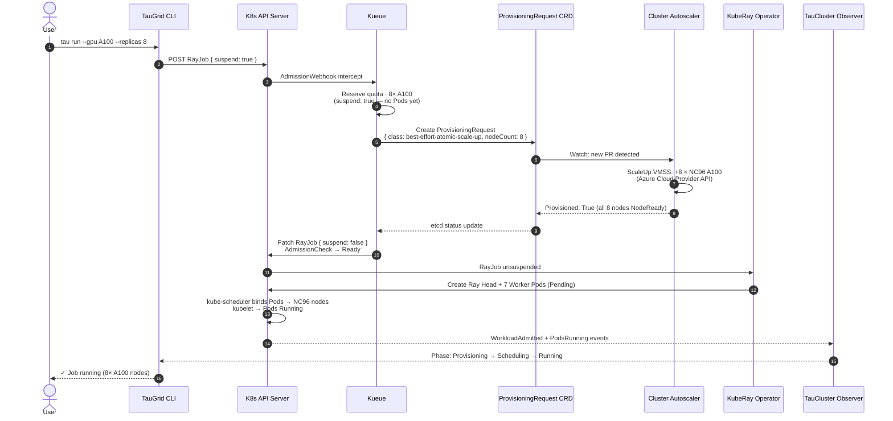
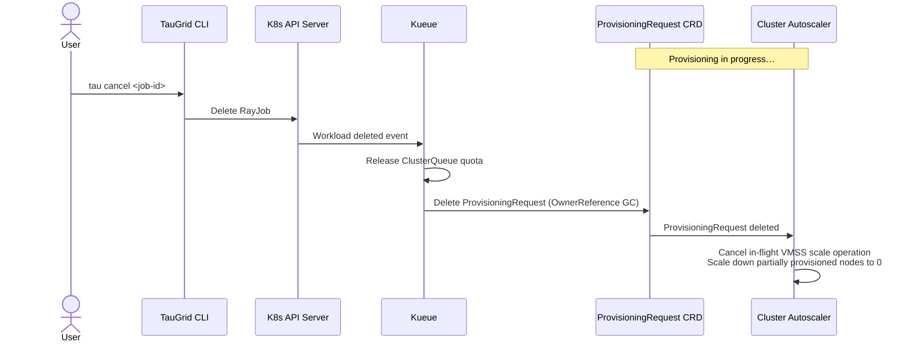
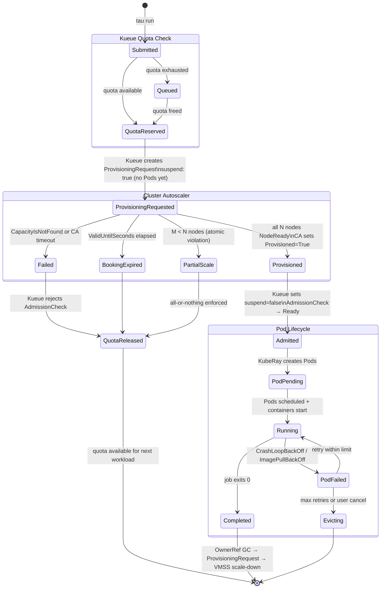
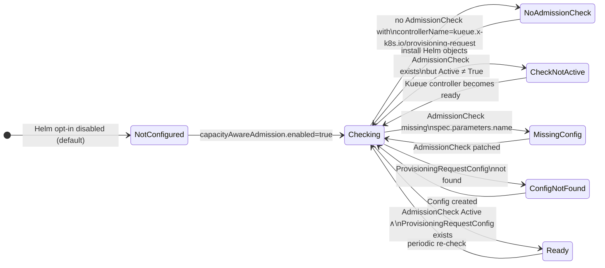

# Capacity-Aware Kueue Admission with Cluster Autoscaler

**Status:** Implementation — `feat/capacity-aware-kueue-admission`
**Issue:** [#278](https://github.com/Azure/taugrid/issues/278)
**Scope:** Single-cluster (v1)

## Problem

Kueue today admits a workload once logical quota is available. Pods remain
`Pending` while Cluster Autoscaler provisions GPU nodes. Researchers cannot
distinguish queue wait from scale-up wait from capacity that will never appear.
A partial scale-up can leave a Ray head node running without its workers,
holding reserved quota indefinitely.

## Goal

Make Kueue wait for CA to confirm actual node provisioning **before**
unsuspending the workload, with atomic (all-or-nothing) gang semantics at the
node level.

---

## Key Decisions

| # | Decision | Rationale |
|---|----------|-----------|
| D1 | Reuse Kueue's ProvisioningRequest AdmissionCheck (`kueue.x-k8s.io/provisioning-request`). TauGrid does not create ProvisioningRequest objects. | Avoids a duplicate controller and stays aligned with upstream Kueue. |
| D2 | No new `tau.yaml` fields in v1. Capacity-aware admission is a platform queue/flavor property. | Keeps the researcher API stable. |
| D3 | No new `executionTarget`. It stays `singleCluster`. | Provisioning is transparent to workload profiles. |
| D4 | MultiKueue and ProvisioningRequest are mutually exclusive on one ClusterQueue. | Kueue enforces this; a ClusterQueue cannot use both admission check controllers. |
| D5 | Helm defaults stay quota-only. Platform engineers opt in via `capacityAwareAdmission.enabled=true`. | Safe default for existing installs. |
| D6 | First AKS provisioning class: `best-effort-atomic-scale-up.autoscaling.x-k8s.io`. The `check-capacity` class only tests existing nodes and cannot scale from zero. | Only `best-effort-atomic-scale-up` triggers VMSS scale-up. |

---

## Architecture

```
┌──────────────────────────────────────────────────────────────────┐
│ TauGrid                                                          │
│  CLI: tau run → RayJob (suspend: true)                          │
│  TauCluster Observer: watches WorkloadAdmitted + PodsRunning     │
│  ProvisioningReady condition: wiring health of AdmissionCheck    │
└──────────────────────┬───────────────────────────────────────────┘
                       │ POST RayJob
┌──────────────────────▼───────────────────────────────────────────┐
│ K8s API Server / Kueue                                           │
│  1. Reserve ClusterQueue quota          (suspend: true)          │
│  2. Create ProvisioningRequest CRD      (autoscaling.x-k8s.io)  │
│  3. Watch ProvisioningRequest status                             │
│  4. Set suspend: false when Provisioned=True                     │
└──────────────────────┬───────────────────────────────────────────┘
                       │ Watch ProvisioningRequest
┌──────────────────────▼───────────────────────────────────────────┐
│ Cluster Autoscaler (AKS managed)                                 │
│  5. Call Azure VMSS API to provision GPU VMs                     │
│  6. Set Provisioned=True when all N nodes are NodeReady          │
│  7. Set Failed / BookingExpired on timeout                       │
└──────────────────────────────────────────────────────────────────┘
```

## Component Ownership

| Component | Responsibility |
|-----------|----------------|
| TauGrid CLI | Renders `suspend: true` workloads with ClusterQueue label |
| TauCluster controller | Observes ProvisioningReady condition; does **not** reconcile ProvisioningRequests |
| Kueue | Reserves quota, creates ProvisioningRequest, sets `suspend: false` on success, releases quota on failure |
| Cluster Autoscaler | Watches ProvisioningRequest CRD; triggers VMSS scale-up; sets `Provisioned: True` or `Failed` |
| Platform engineer | Enables autoscaling on GPU node pool; installs Helm opt-in objects; applies ClusterQueue patch |

---

## 10-Step Workload Lifecycle

```
 1. [CLI]        tau run → TauGrid renders RayJob with suspend: true
 2. [K8s API]    RayJob submitted → Kueue admission webhook
 3. [Kueue]      ClusterQueue quota reserved — no Pods yet
 4. [Kueue]      ProvisioningRequest created (best-effort-atomic-scale-up, 8× NC96)
 5. [CA]         VMSS scale-up triggered via Azure Cloud Provider API
 6. [CA]         All 8 nodes NodeReady → Provisioned: True on ProvisioningRequest
 7. [Kueue]      AdmissionCheck → Ready; suspend: false set on RayJob
 8. [KubeRay]    Ray Head + 7 Worker Pods created (Pending)
 9. [Scheduler]  Pods bound to NC96 nodes via nodeAffinity (agentpool label)
10. [TauGrid]    Observer streams: Capacity Provisioning → Pod Scheduling → Running
```

### Sequence Diagram — Happy Path



### Sequence Diagram — Cancellation During Scale-Up



---

## New Status Phase

`tau run status --watch` gains a new phase:

```
Queued → Capacity Provisioning → Pod Scheduling → Running
```

If the provisioning check is **Rejected**, `--watch` fails immediately rather
than hanging. A new `ProvisioningReady` condition on `TauCluster` reflects the
platform-level wiring health and fails closed for affected profiles.

---

## Implementation

### New files

| File | Purpose |
|------|---------|
| `controllers/tau-core/internal/controller/provisioning_ready.go` | `ProvisioningReadinessReader` interface and `KubernetesProvisioningReadiness` observer |
| `charts/taugrid/templates/capacity-aware-admission.yaml` | Helm objects: `ProvisioningRequestConfig`, `AdmissionCheck`, `ResourceFlavor` |

### Modified files

| File | Change |
|------|--------|
| `controllers/tau-core/api/v1alpha1/types.go` | Add `ConditionProvisioningReady = "ProvisioningReady"` |
| `controllers/tau-core/internal/controller/cluster_controller.go` | Add `ProvisioningReadiness` field; call observer; watch `AdmissionCheck`; include condition in status |
| `charts/taugrid/values.yaml` | Add `capacityAwareAdmission` section (disabled by default) |

### Wiring in `main.go` (required when enabling)

```go
if cfg.CapacityAwareAdmissionEnabled {
    reconciler.ProvisioningReadiness = &controller.KubernetesProvisioningReadiness{
        Reader: mgr.GetAPIReader(),
    }
}
```

---

## Kubernetes Manifest Examples

### ProvisioningRequestConfig

```yaml
apiVersion: kueue.x-k8s.io/v1beta1
kind: ProvisioningRequestConfig
metadata:
  name: taugrid-provisioning-request-config
spec:
  provisioningClassName: best-effort-atomic-scale-up.autoscaling.x-k8s.io
  managedResources:
  - nvidia.com/gpu
  parameters:
    ValidUntilSeconds: "600"
```

### AdmissionCheck

```yaml
apiVersion: kueue.x-k8s.io/v1beta2
kind: AdmissionCheck
metadata:
  name: taugrid-provisioning-admission-check
spec:
  controllerName: kueue.x-k8s.io/provisioning-request
  retryDelayMinutes: 1
  parameters:
    apiGroup: kueue.x-k8s.io
    kind: ProvisioningRequestConfig
    name: taugrid-provisioning-request-config
```

### ResourceFlavor (scale-from-zero GPU)

```yaml
apiVersion: kueue.x-k8s.io/v1beta1
kind: ResourceFlavor
metadata:
  name: taugrid-gpu-scale-from-zero
spec:
  nodeLabels:
    kubernetes.azure.com/agentpool: gpupool
    node.kubernetes.io/instance-type: Standard_NC96ads_A100_v4
  tolerations:
  - key: sku
    value: gpu
    operator: Equal
    effect: NoSchedule
```

### ClusterQueue patch (cluster-overlays)

```yaml
apiVersion: kueue.x-k8s.io/v1beta1
kind: ClusterQueue
metadata:
  name: cluster-queue
spec:
  admissionChecksStrategy:
    admissionChecks:
    - name: taugrid-provisioning-admission-check
      onFlavors:
      - taugrid-gpu-scale-from-zero   # scoped to GPU flavor only
```

### Sample RayJob

```yaml
apiVersion: ray.io/v1
kind: RayJob
metadata:
  name: llm-finetuning
  namespace: tau-user-workspace
  labels:
    kueue.x-k8s.io/queue-name: jobqueue
spec:
  suspend: true   # TauGrid always sets this
  entrypoint: "python train.py"
  rayClusterSpec:
    headGroupSpec:
      rayStartParams:
        num-cpus: "0"
      template:
        spec:
          containers:
          - name: ray-head
            image: rayproject/ray:2.40.0-py311-gpu
    workerGroupSpecs:
    - groupName: gpu-workers
      replicas: 8
      rayStartParams:
        num-gpus: "4"
      template:
        spec:
          tolerations:
          - key: sku
            value: gpu
            operator: Equal
            effect: NoSchedule
          containers:
          - name: ray-worker
            image: rayproject/ray:2.40.0-py311-gpu
            resources:
              requests:
                nvidia.com/gpu: "4"
              limits:
                nvidia.com/gpu: "4"
```

---

## State Machine

### Workload Lifecycle States



### ProvisioningReady Condition on TauCluster



---

## Failure Modes

| Scenario | Trigger | Resolution |
|----------|---------|------------|
| Cloud capacity exhaustion | CA marks ProvisioningRequest `Failed` / `CapacityIsNotFound` | Kueue rejects AdmissionCheck, releases quota immediately |
| Booking expiry | `ValidUntilSeconds` elapsed, `Provisioned: True` not set | Same as Failed; Kueue retries up to `retryLimit` |
| Partial scale-up (atomic violation) | Cloud provisions M < N requested nodes | `best-effort-atomic-scale-up` rejects; atomic cancel; quota released |
| ImagePullBackOff / CrashLoopBackOff | Nodes provisioned but runtime fails | TauGrid retry policy; on max retries Workload deleted → OwnerRef GC → CA scale-down |
| User cancellation during scale-up | `tau cancel` while ProvisioningRequest pending | Workload deleted → GC → CA cancels in-flight VMSS operation |
| Label mismatch | ResourceFlavor nodeLabels don't match AKS pool labels | Pods stay Pending; fix `gpuFlavor.agentPool` / `instanceType` in Helm values |
| MultiKueue conflict | ClusterQueue has both MultiKueue and provisioning checks | Kueue rejects ClusterQueue config; use separate ClusterQueues |

### Timeout reference

| Parameter | Default | Description |
|-----------|---------|-------------|
| `bookingExpirationSeconds` | 600 | Seconds for CA to set `Provisioned: True` |
| `minBackoffSeconds` | 60 | Initial retry delay after failure |
| `maxBackoffSeconds` | 1800 | Max retry delay (exponential back-off ceiling) |
| `retryLimit` | 3 | Max retries before permanent rejection |

---

## Enabling (Platform Engineer Runbook)

```bash
# 1. Enable autoscaling on the AKS GPU node pool (min-count=0)
az aks nodepool update \
  --cluster-name <cluster> \
  --resource-group <rg> \
  --name gpupool \
  --enable-cluster-autoscaler \
  --min-count 0 --max-count 8

# 2. Install the Helm opt-in objects
helm upgrade taugrid ./charts/taugrid \
  --set capacityAwareAdmission.enabled=true \
  --set capacityAwareAdmission.gpuFlavor.agentPool=gpupool \
  --set capacityAwareAdmission.gpuFlavor.instanceType=Standard_NC96ads_A100_v4

# 3. Patch ClusterQueue in cluster-overlays
kubectl apply -f cluster-overlays/<cluster>/clusterqueue-patch.yaml

# 4. Verify TauCluster ProvisioningReady condition
kubectl get cluster -o jsonpath='{.status.conditions[?(@.type=="ProvisioningReady")]}'
```

---

## Open Questions

1. **`onFlavors` scope**: Should `admissionChecksStrategy.onFlavors` be explicit (recommended) or empty (gates all flavors)?
2. **`ProvisioningReady` granularity**: Cluster-wide condition only, or per-profile condition as well? Recommendation: both.
3. **AKS GPU lab**: Is a GPU scale-from-zero lab required before GA, or is a CPU-equivalent prototype sufficient?

---

## Worked Example

**Not yet demonstrated end to end.** A partial run on the `helmdeep-aks` AKS
cluster (2026-10-12, upstream Kueue v0.20.1) is logged in
[`docs/design/examples/cpu-demo/README.md`](examples/cpu-demo/README.md).
No ProvisioningRequest was created and no timings were measured.

What the run established:

- AKS does not install the `ProvisioningRequest` CRD. Without it Kueue logs
  `Skipping provisioning controller setup: Provisioning Requests not supported`
  and the AdmissionCheck can never become Active.
- Whether the AKS managed Cluster Autoscaler answers ProvisioningRequests is
  unverified. This is the main open risk for the design.
- Kueue v0.20.1 serves only `kueue.x-k8s.io/v1beta2`. The `v1beta1` manifests
  and GVK in this branch are rejected there (not checked on the pinned v0.19.2).
- `spec.retryDelayMinutes` is not a field of `v1beta2` `AdmissionCheck`; the
  chart template is rejected by the API server. Retry settings belong in
  `ProvisioningRequestConfig.spec.retryStrategy`.

---

## Follow-up Checklist

- [ ] Wire `ProvisioningReadiness` reader in `cmd/controller/main.go` behind a feature flag / env var
- [ ] Update `tau run status --watch` to surface the `Capacity Provisioning` phase
- [ ] Fail `--watch` on `ProvisioningReady: False` / `Reason: ProvisioningAdmissionCheckNotReady`
- [ ] Add unit tests in `provisioning_ready_test.go`
- [ ] Add example `cluster-overlays/` ClusterQueue patch
- [ ] Update Terraform docs with agentpool `min_count=0` note
- [ ] Helm opt-in values schema (`values.schema.json`) update
- [ ] License-header check on `provisioning_ready.go`
