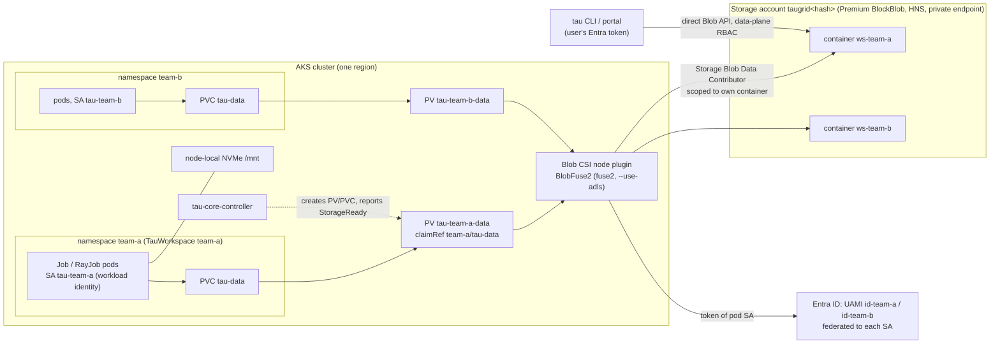

# Managed storage for TauGrid workloads

Status: **proposal, awaiting review.** No production code is written yet. A
runnable prototype of the runtime contract (section 11) is in
[`examples/managed-storage-prototype`](../../examples/managed-storage-prototype).

GitHub: no issue filed yet. Proposed title: *"[Feature]: Design managed durable
storage for workloads"*.

Scope: a TauGrid system contract for durable workload storage covering
datasets, checkpoints, shared working state and outputs. **TauGrid is a control
plane only. Every byte of data, and every I/O, caching, replication and
durability guarantee, lives in the storage provider's data plane.** TauGrid
declares which storage a workspace uses, binds it into the workload, gives the
workload an identity to reach it, and reports whether it works. It never
stores, proxies, caches or replicates data. Researchers keep `tau run` /
`status` / `cancel` and get a working `/data` without naming or creating a
PVC. Platform teams declare storage classes once on `TauCluster`.

Providers: the API is provider-neutral. A storage class is a CSI driver, a
parameter template, an identity mode and a set of declared capabilities
(sections 3.0 and 6.1). **Azure (Blob with hierarchical namespace, Managed
Lustre, local NVMe) is the first reference provider** and the one this document
works through in detail. AWS (S3, FSx for Lustre, EFS), GCP (Cloud Storage,
Parallelstore, Filestore) and on-prem systems (Ceph, NFS, Lustre, WEKA, VAST)
plug in as classes, not as new controller code. Any RWX PVC keeps working in
`External` mode.

This is a **workflow and lifecycle design**. It is not a storage system, not a
storage gateway, not a CSI driver, and not cloud provisioning
([ROADMAP.md](../../ROADMAP.md) "Not planned"). TauGrid manages the Kubernetes
objects and the contract between them. Cloud resources come from IaC. Data
flows between workloads and the provider directly.

## Decisions proposed (review these first)

| # | Decision | Consequence |
|---|---|---|
| D0 | **TauGrid is a control plane only; the data plane is the provider's.** No TauGrid component (controller, CLI, portal, status pipeline) sits in the data path: no storage gateway, proxy, cache, replicator or sync service. | Bytes flow pod → provider CSI driver → provider service, and user or CLI → provider API directly with the caller's own credentials. A TauGrid outage cannot affect running I/O. Durability, throughput, encryption, versioning and replication are the provider's guarantees and are *declared and reported*, never provided. See section 0. |
| D1 | **TauGrid owns storage *bindings*, never cloud resources.** The controller creates and deletes PV/PVC objects, mount wiring and the path convention. It never calls any cloud provider's resource-management API (ARM, AWS, GCP). | Storage accounts, containers, AMLFS and role assignments come from Terraform (new opt-in module in [`terraform/aks`](../../terraform/aks)) or other IaC. Matches ROADMAP "Not planned: cloud or cluster provisioning". |
| D2 | **Reuse the TauCluster ownership vocabulary: `External` / `Adopt` / `Manage`.** The default is `External`, which is today's behavior. | Existing clusters see only new *observed* status (`StorageReady`) until an operator opts in. No researcher-visible change on upgrade. |
| D3 | **Azure reference provider, durable tier = Premium block blob account with hierarchical namespace, one container per workspace, mounted by BlobFuse2 via a static Blob CSI PV, authenticated as the workspace identity.** | Azure enforces isolation between workspaces, not only Kubernetes RBAC. Directory rename becomes a single metadata operation, which existing publish paths rely on. Depends on the Blob CSI `mountWithWorkloadIdentityToken` option, which is **preview**. See section 3.4 and open question 1. Other providers supply an equivalent class (section 3.0); the controller has no Azure-specific code. |
| D4 | **The in-pod path contract does not change.** `/data`, `/mnt`, the `TAU_*_DIR` variables and the layouts in [`storage/paths.go`](../../cli/internal/storage/paths.go) stay exactly as they are. | Managed storage changes *where* `/data` comes from, not what it looks like. Every example, registry and resume path keeps working. |
| D5 | **Durability is defined by commit markers, not by POSIX semantics.** A checkpoint, dataset version or artifact set exists only once its marker is written with the provider's create-if-absent primitive (a conditional write: `If-None-Match: *` on Azure Blob and S3, `ifGenerationMatch=0` on GCS, `O_EXCL` only on filesystems that honor it). Data goes to writer-unique generation paths. | A client-side convention that runs inside the workload against the provider. TauGrid stores nothing and enforces nothing. Each class declares which primitives it offers (section 4.2) and submit refuses configs that need one the class lacks. Generalizes what [`artifactpublish`](../../cli/internal/artifactpublish) and the dataset registry's `If-None-Match` writes already do. |
| D6 | **No new required `tau.yaml` fields.** `storage.data_pvc` defaults to the workspace's managed claim from `TauWorkspace.status.storage`, the same way the queue defaults from workspace status. An explicit `data_pvc` still wins. | Checked-in configs that name `blob-training` keep working. New configs can omit storage entirely. |
| D7 | **Scratch-on-NVMe and the AMLFS fast tier are optional, per-cluster classes**, off by default and targeted at v1.1. | v1 ships the durable tier, status and CLI. Fast tiers reuse the same API without re-litigating it. |
| D8 | **MultiKueue stays per-cluster.** Each worker binds its own workspace volume. TauGrid does not replicate data across regions or clusters, as in the current contract; cross-region replication is a provider feature a class may opt into (GRS, S3 replication, dual-region buckets). | Same claim *name* and class on every worker. [`checkStorageClassParity`](../../cli/internal/platform/preflight.go) keeps working unchanged. |

---

## 0. Control plane / data plane boundary

This is the rule every other section is checked against.

| | Control plane (TauGrid) | Data plane (provider) |
|---|---|---|
| Owns | Which class a workspace uses; the PV/PVC that binds it; which service account carries which identity; `StorageReady`; the `Volume mount` run phase; pre-submit checks; the path convention (`/data`, `/mnt`) | Bytes, I/O, caching, durability, replication, encryption at rest, versioning and recovery, throttling, billing, capacity, **enforcement of access (IAM)** |
| Code that runs | `tau-core-controller`, `tau` CLI, portal | Provider CSI driver (node plugin) and the provider's storage service |
| Failure effect | New binds and status stall; **running I/O is unaffected** | I/O errors or slowness; TauGrid can surface it, not mask it |
| Credentials | Never holds storage credentials; references identities | Validates tokens against its own IAM |

```mermaid
flowchart LR
  subgraph CP["Control plane: TauGrid"]
    ctrl["tau-core-controller<br/>PV/PVC, StorageReady"]
    cli["tau CLI and portal<br/>resolve, preflight, status"]
  end
  subgraph K8S["Kubernetes nodes"]
    pod["workload pods"]
    csi["provider CSI driver"]
  end
  subgraph DP["Data plane: provider"]
    svc[("object or file service<br/>durability, IAM, replication")]
  end
  ctrl -. "declares and binds (objects only)" .-> csi
  cli -. "reads status, never bytes" .-> ctrl
  pod -- "read and write /data" --> csi
  csi -- "bytes" --> svc
  cli -- "tau storage: caller's own credentials" --> svc
```



Test for any feature: if it needs TauGrid to **hold, move, transform or serve
bytes**, it is out of scope. If it can be expressed as a Kubernetes object, a
status condition, a credential binding or a pre-submit check, it is in scope.

What this rules out, and what it changes:

1. **No TauGrid storage service.** `tau storage` is a client that talks to the
   provider with the *caller's* credentials (section 8.3). It is optional and
   no TauGrid server relays its bytes.
2. **The helper-pod read/write path is legacy.** Today `tau run get`, the model
   and dataset registries move file contents through a pod's logs and the
   Kubernetes API server ([`pvc_helpers.go`](../../cli/internal/cli/pvc_helpers.go)).
   That puts the cluster in the data path. It stays only as the `External`
   fallback and is retired for managed workspaces.
3. **The checkpoint protocol is a convention, not a service.** The SDK helper
   (section 8.5) is a library inside the user's process that talks to the
   provider. TauGrid runs no daemon for it and cannot enforce it.
4. **Guarantees are the provider's.** TauGrid can say "the claim is bound, the
   driver is registered and the identity is wired". It cannot say "your data is
   durable". Classes therefore *declare capabilities* (section 4.2) and
   TauGrid refuses configs that need a capability the class does not declare.
5. **Failure isolation is a feature.** A controller crash, an upgrade or an
   API-server outage leaves mounted pods reading and writing.

What we give up by staying a control plane: no unified quota or `ENOSPC`
across providers (capacity is reported where the provider exposes it, section
9), no TauGrid-managed cross-provider data movement or replication, and no
server-side garbage collection (`tau storage gc` is client-side). Each of those
would need TauGrid to run in the data path. The roadmap already lists portable
data under "Exploring", and it should be designed there.

---

## 1. Context

### 1.1 User problem

A researcher who wants a checkpoint to outlive a pod has to:

1. Find out which PVC exists in their workspace namespace and what it is
   called (`blob-training`? `<datasets-pvc>`? something else?).
2. Ask a platform owner to create one if none exists, because researchers
   have read-only access to PVCs.
3. Learn the backend's caveats (BlobFuse "no concurrent writes", "rank 0 writes
   checkpoints", list caching) from comments in example YAML.
4. Hope that the claim is Bound, that the CSI driver runs on the nodes their
   profile selects, and that their identity can read the bytes.

Platform owners, for their part, must hand-write StorageClass/PV/PVC YAML per
namespace. They must choose between node-identity mounts, which share one
identity across every workspace, and per-workspace secrets. They must also
keep that YAML aligned across MultiKueue workers. Nothing in TauGrid reports
whether any of it works: a workspace can be `Ready` while its storage is
missing.

### 1.2 What already exists (verified against `main` @ `92f92e7`)

| Claim | Evidence |
|---|---|
| Storage is explicitly external in 0.1; lifecycle is a "post-0.1 fast-follow" | [`cluster-overlays/azure/storage/README.md`](../../cluster-overlays/azure/storage/README.md) lines 3–7 and 107–108 |
| Two-path contract: `/data` = named PVC, `/mnt` = node-local `emptyDir` | same README, table at lines 10–15; [`storage/paths.go`](../../cli/internal/storage/paths.go) constants `DurableRoot`, `HotRoot` |
| Renderers mount `/data` only from `PVCMount` and add `tau-hot` `emptyDir` at `/mnt` automatically | [`jobrender/render.go`](../../cli/internal/jobrender/render.go) `buildStoragePlan`, lines 1280–1316 |
| Runtime env contract `TAU_DATA_DIR`, `TAU_HOT_DIR`, `TAU_{,DURABLE_}{DATASETS,CHECKPOINTS}_DIR` | [`storage/env.go`](../../cli/internal/storage/env.go) |
| `/mnt` is probed at start (free space, write MB/s) and falls back to `/data` | [`storageprobe/preflight.go`](../../cli/internal/storageprobe/preflight.go) lines 8–107 |
| Submit preflight requires the named PVC to exist and be Bound, and the PV's CSI driver to be registered on every node the profile selects | [`cli/storage_preflight.go`](../../cli/internal/cli/storage_preflight.go) lines 114–196, 248–286 |
| Run config has `storage.data_pvc`, `result_pvc`, `output`, `publish`, `volumes`, `mounts`, `checkpoint` | [`runconfig/schema.go`](../../core/runconfig/schema.go) lines 125–137; [`runconfig/config.go`](../../core/runconfig/config.go) `type Storage`, lines 234–251 |
| Model registry, dataset registry and `tau run get` read and write through **busybox helper pods** that base64 files through pod logs | [`cli/pvc_helpers.go`](../../cli/internal/cli/pvc_helpers.go) lines 148–233; `writePVCFile` in [`cli/model.go`](../../cli/internal/cli/model.go) line 908 |
| Helper pods sleep 12 s before trusting an empty BlobFuse listing | `pvcHelperListSettleDelay`, [`pvc_helpers.go`](../../cli/internal/cli/pvc_helpers.go) lines 32–34 |
| Registries hard-code the claim `blob-training` regardless of what runs used | `defaultTauPVCName` ([`pvc_helpers.go`](../../cli/internal/cli/pvc_helpers.go) line 24); `newPVCBackend` ([`dataset_store.go`](../../cli/internal/cli/dataset_store.go) line 51); every `fetchModelRegistry*` call in [`model.go`](../../cli/internal/cli/model.go) |
| The helper-pod registry path has a documented TOCTOU on create; the Azure SDK path uses server-enforced `If-None-Match: *` | [`dataset_store.go`](../../cli/internal/cli/dataset_store.go) lines 64–75; [`dataset_sdk_backend.go`](../../cli/internal/cli/dataset_sdk_backend.go) lines 140–160 |
| Registry and model writes rely on `mv tmp path` | [`model.go`](../../cli/internal/cli/model.go) lines 920–927 |
| Staged artifact publication already uses generation directories + a completion marker | [`artifactpublish`](../../cli/internal/artifactpublish) `GenerationsDir`, `CompletionMarker` |
| Resume defaults to `/data/checkpoints/finetunes/<name>` via `TAU_RESUME_FROM` | [`cli/run_resume.go`](../../cli/internal/cli/run_resume.go) lines 260–267, 406 |
| `TauWorkspace` has no storage field and no storage condition. Docs warn `Ready` does not mean storage works | [`api/v1alpha1/types.go`](../../controllers/tau-core/api/v1alpha1/types.go) lines 308–346; [`reference/workspace.md`](../../site/content/en/docs/reference/workspace.md) line 52 |
| `TauWorkspace.spec.workloadIdentity` already creates a federated service account, and runs use it | `reconcileWorkloadIdentity`, [`workspace_rbac.go`](../../controllers/tau-core/internal/controller/workspace_rbac.go) line 97; [`run_workspace.go`](../../cli/internal/cli/run_workspace.go) lines 124–127; renderers set `serviceAccountName` ([`jobrender`](../../cli/internal/jobrender/render.go) line 773, [`rayjobrender`](../../cli/internal/rayjobrender/render.go) line 575) |
| `TauCluster` has an `External`/`Adopt`/`Manage` ownership model and `Retain`/`DeleteManaged` deletion policy | [`types.go`](../../controllers/tau-core/api/v1alpha1/types.go) lines 22–30, 119–163 |
| Researcher role can only `get/list/watch` PVCs. The controller has no PV/PVC RBAC | [`charts/tau-core-controller/templates/rbac.yaml`](../../charts/tau-core-controller/templates/rbac.yaml) line 17; controller RBAC markers in [`cluster_controller.go`](../../controllers/tau-core/internal/controller/cluster_controller.go) lines 62–70 |
| Workspace namespaces enforce PSA `baseline` (CSI inline volumes are allowed) | [`workspace_namespace.go`](../../controllers/tau-core/internal/controller/workspace_namespace.go) lines 123–125 |
| AKS Terraform enables OIDC issuer + workload identity, but not the Blob CSI driver, and creates no storage | [`terraform/aks/main.tf`](../../terraform/aks/main.tf) lines 13–51 |
| Bootstrap workspace sets `outputRoot: /data/projects/<ws>/runs` with no claim behind it | [`bootstrap-workspace.yaml.tftpl`](../../terraform/aks/bootstrap-workspace.yaml.tftpl) |
| Run status has no storage phase. Mount problems surface only as a substring match on `"mount"` in init-container reasons | [`core/status/phases.go`](../../core/status/phases.go) lines 59–81, 619–651 |
| MultiKueue parity preflight checks the claim name and StorageClass across workers | [`platform/preflight.go`](../../cli/internal/platform/preflight.go) line 407 |

### 1.3 Gaps this design closes

1. **Provisioning:** no supported path from "new workspace" to "working `/data`".
2. **Isolation:** the zero-config Blob example mounts as the kubelet identity,
   so any pod on a node can reach any container that identity can reach.
3. **Semantics:** correctness rules for checkpoints are folklore in YAML
   comments, and flat-namespace BlobFuse makes directory rename a per-object
   operation.
4. **Observability:** no `StorageReady`, and no run phase between "pod
   scheduled" and "container started" that explains mount failures.
5. **Data access:** CLI reads go through helper pods, base64 over logs and a
   12 s settle delay, against a hard-coded claim name.

---

## 2. Storage model

Three tiers, of which only the first two are in v1:

| Tier | Mount | Backing (Azure example) | Survives | Guarantees (the provider's, declared per class) | Typical content |
|---|---|---|---|---|---|
| **Durable** (v1) | `/data` | Workspace container on an HNS Premium block blob account, BlobFuse2 | pod, node, cluster scale-to-zero, workspace deletion (`Retain`) | per-object atomic writes; create-if-absent markers; directory rename is one metadata operation (HNS) | datasets, committed checkpoints, outputs, registries |
| **Scratch** (v1: `emptyDir`; v1.1: NVMe class) | `/mnt` | node-local disk; NVMe on GPU SKUs that have it | container restarts only | full POSIX; fast; **lost with the pod/node** | staged dataset shards, in-progress checkpoints, compile caches |
| **Shared fast** (v1.1, opt-in) | `/lustre` | AMLFS with blob integration on the same workspace container | pod, node | full POSIX, parallel, multi-writer | multi-node shared scratch, high-frequency checkpoints of very large models |

The rule researchers learn is one sentence: *write to `/mnt`, commit to
`/data`, resume only from what is committed.* The SDK (section 8.5) and
`storage.publish: staged` implement it so most researchers never write the
protocol themselves.

---

## 3. Providers and cloud infrastructure (Azure is the first reference provider)

### 3.0 Provider model

The controller contains **no provider-specific code**. A storage class
(section 6.1) is data:

* `csi.driver`: which CSI driver mounts it. Must be on the controller's
  allow-list.
* `csi.volumeAttributes` and `volumeHandle`: a template. The only substitutions are `{workspace}`,
  `{namespace}`, `{serviceAccount}` and `{identity.*}`, so rendering a PV is string
  substitution plus validation.
* `identity.mode`: `workloadIdentity` (the pod's service account is federated
  to a cloud identity authorized on that workspace's data only), `nodeIdentity`
  (shared, visible as a warning) or `none`.
* `capabilities`: what the provider and driver can do (section 4.2).

Adding a provider means adding a class preset and a documentation page. It
does not mean a new controller, a new CRD version or new Go code. Azure ships as
the first preset and Terraform module because that is where TauGrid is tested
end to end.

| | Azure (reference) | AWS | GCP | On-prem / other |
|---|---|---|---|---|
| Durable object tier | Blob + hierarchical namespace, `blob.csi.azure.com` (BlobFuse2) | S3 via Mountpoint CSI, `s3.csi.aws.com`; **static provisioning only** (verified) | Cloud Storage via GCS FUSE CSI, `gcsfuse.csi.storage.gke.io` (confirm) | Ceph RGW or MinIO through an S3 CSI, or any RWX filesystem |
| Shared POSIX fast tier | Managed Lustre, `azurelustre.csi.azure.com` | FSx for Lustre `fsx.csi.aws.com`, EFS `efs.csi.aws.com` (confirm) | Parallelstore, Filestore (confirm) | Lustre, CephFS, WEKA, VAST, NFS |
| Node-local scratch | local NVMe (Azure Container Storage local CSI) | instance-store NVMe | Local SSD | node disks |
| Pod → storage identity | Workload identity: UAMI federated to the service account. The Blob CSI option is **preview** (verified) | IAM roles for service accounts or EKS Pod Identity (confirm per driver version) | Workload Identity Federation for GKE (verified). Uniform bucket-level access is required for read-write (verified) | the system's own (Kerberos, tokens, export policies) |
| Conditional create through the API | `If-None-Match: *`, used today by [`sdkAzBackend`](../../cli/internal/cli/dataset_sdk_backend.go) | `If-None-Match: *`, **412** on conflict (verified) | `ifGenerationMatch=0` (confirm) | `O_EXCL` on a POSIX filesystem |
| Directory rename on the object tier | atomic with HNS, per-object without (verified) | **not supported on any S3 bucket type**; file rename only on S3 Express One Zone (verified) | atomic folder rename on HNS buckets (confirm) | native |
| Write model through the mount | BlobFuse2: concurrent writers to one file give unexpected results (verified) | Mountpoint: sequential writes, one writer, no locks, no `chmod`; overwriting needs an opt-in flag (verified) | see GCS FUSE semantics (confirm) | filesystem-specific |

"verified" means read in vendor documentation while writing this design
([Mountpoint semantics](https://github.com/awslabs/mountpoint-s3/blob/main/doc/SEMANTICS.md),
[S3 conditional writes](https://docs.aws.amazon.com/AmazonS3/latest/userguide/conditional-writes.html),
[GCS FUSE CSI](https://docs.cloud.google.com/kubernetes-engine/docs/concepts/cloud-storage-fuse-csi-driver),
and the Azure pages cited below). "confirm" means taken from prior knowledge and
**must be re-checked against the driver version** before a preset ships. Driver
names and option spellings in section 6.1's AWS and GCP examples are
illustrative for the same reason.

The rest of section 3 is the Azure reference provider in detail.

### 3.1 Azure reference architecture



What each Azure resource is for, and who creates it:

| Resource | Created by | Scope | Notes |
|---|---|---|---|
| Storage account, `Premium` / `BlockBlobStorage`, `is_hns_enabled = true` | Terraform (new) | one per cluster/region by default | Optional `accountRef` per workspace for tenants who need their own account (section 3.6). |
| Container (filesystem) per workspace | Terraform `for_each` over workspaces | workspace | Name `ws-<workspace>`. Holds exactly the `/data` tree. |
| User-assigned managed identity per workspace | Terraform | workspace | Already modeled: `TauWorkspace.spec.workloadIdentity.clientId`. |
| Federated identity credential | Terraform | workspace SA `system:serviceaccount:<ns>:<sa>` | Same pattern Terraform already uses for portal, adx-mon and lifecycle recorder ([`main.tf`](../../terraform/aks/main.tf) lines 188–226). |
| Role assignment: *Storage Blob Data Contributor* on the container | Terraform | container | This makes the isolation real: identity A cannot read container B. |
| Role assignment: *Storage Blob Data Reader* (or *Contributor*) for the workspace's Entra group | Terraform | container | Lets `tau storage` and the portal read data directly with the user's token (section 8.3). |
| Blob CSI driver | AKS `storage_profile { blob_driver_enabled = true }` | cluster | Not enabled by today's Terraform. |
| Private endpoint + private DNS zone | Terraform (default on) | account | Keeps data-plane traffic on the VNet. |
| Container soft delete + blob soft delete | Terraform | account | Recovery from `rm -rf`. See section 3.5 for versioning. |
| AMLFS (v1.1) | Terraform, optional | cluster/region | HSM settings point at the workspace container(s). |

The controller needs **no Azure credentials**. It reads the account and
container names from `TauCluster.spec.storage` and writes Kubernetes objects.

### 3.2 Azure durable tier: options considered

| Option | Dir rename | Multi-writer to one file | Throughput scaling | Cost model | Isolation per workspace | Verdict |
|---|---|---|---|---|---|---|
| Blob, flat namespace, BlobFuse (today's example) | per-blob copy+delete; not atomic, slow for large trees | unsafe (last writer wins) | scales with account limits | pay per GB used + transactions | only with per-PV credentials; example uses kubelet MI | **Replace as default** |
| **Blob + HNS (ADLS Gen2), BlobFuse2 `--use-adls`** | single directory-entry update | unsafe; same as above | same account limits | same as above | **workload identity + container-scoped RBAC** | **Chosen v1 default** |
| Blob NFS 3.0 | server-side rename | unsafe; no locking guarantees | good | pay per use | network-level (VNet rules), no per-identity auth | Viable `External` choice; weaker identity story |
| Azure Files Premium (NFS/SMB) | atomic | POSIX-ish locking (SMB) | provisioned-size bound | provisioned | NFS: network only; SMB: key/secret | Good for small shared state, not dataset scale |
| Azure NetApp Files | atomic | full NFS | high, provisioned | provisioned, capacity pools | network/export policy | Enterprise `External` option |
| AMLFS | atomic | full POSIX, parallel | very high (see 3.7) | **provisioned 24/7**, large minimums | network only | Fast tier, not the durable default |
| Local NVMe | atomic | full POSIX | highest | free with VM | n/a | Scratch only; lost with node |

Why HNS matters to TauGrid specifically: [`writePVCFile`](../../cli/internal/cli/model.go)
commits registry records with `mv tmp path`. `artifactpublish` commits
generation directories by rename. Every checkpoint library writes
`ckpt.tmp/` then renames it. Microsoft's ADLS Gen2 documentation states that
without a hierarchical namespace, directory moves and renames require
processing "potentially millions of individual blobs". With one, the task is
done "by updating a single entry (the parent directory)"
([ADLS Gen2 namespace](https://learn.microsoft.com/azure/storage/data-lake-storage/namespace)).
For multi-GB checkpoint directories, that is the difference between a commit
that is effectively instant and one that copies every byte a second time.

What HNS does **not** fix, per the
[BlobFuse2 known issues](https://docs.azure.cn/en-us/storage/blobs/blobfuse2-known-issues):
concurrent writers to one file are still last-writer-wins. `flock` and hard
links are unsupported. Changes made by other mounts are not continuously
synchronized. Kernel caching can serve stale directory views. This is why D5
defines correctness with markers instead of filesystem semantics.

### 3.3 Mount configuration (rendered by the controller)

```yaml
apiVersion: v1
kind: PersistentVolume
metadata:
  name: tau-team-a-data
  labels:
    tau.azure.com/workspace: team-a
    app.kubernetes.io/managed-by: tau-core-controller
  annotations:
    pv.kubernetes.io/provisioned-by: blob.csi.azure.com
spec:
  capacity: {storage: 10Ti}            # advisory for Blob; quota is enforced elsewhere (section 9)
  accessModes: [ReadWriteMany]
  persistentVolumeReclaimPolicy: Retain
  storageClassName: tau-durable        # name only; no provisioner runs for static PVs
  claimRef: {namespace: team-a, name: tau-data}   # pre-bound: no other claim can take it
  mountOptions:
    - --use-adls=true
    - -o allow_other
    - --block-cache                     # streaming large sequential I/O (checkpoints, shards)
    - --block-cache-block-size=16       # MiB; tuned per class
    - --attr-timeout=120
    - --entry-timeout=120
    - --negative-timeout=0              # a just-written marker must not be hidden by a cached ENOENT
  csi:
    driver: blob.csi.azure.com
    volumeHandle: taugrid3f1c#ws-team-a#tau-team-a   # unique per workspace
    volumeAttributes:
      storageAccount: taugrid3f1c
      containerName: ws-team-a
      resourceGroup: rg-taugrid-data
      protocol: fuse2
      ClientID: 00000000-0000-0000-0000-00000000000a  # TauWorkspace.spec.workloadIdentity.clientId
      mountWithWorkloadIdentityToken: "true"          # mount as the *pod's* SA (preview)
---
apiVersion: v1
kind: PersistentVolumeClaim
metadata:
  name: tau-data
  namespace: team-a
  labels: {tau.azure.com/workspace: team-a, app.kubernetes.io/managed-by: tau-core-controller}
spec:
  accessModes: [ReadWriteMany]
  storageClassName: tau-durable
  volumeName: tau-team-a-data
  resources: {requests: {storage: 10Ti}}
```

`--use-adls=true`, `protocol: fuse2`, `ClientID` and
`mountWithWorkloadIdentityToken` are the documented static-PV knobs
([AKS static Blob volumes](https://learn.microsoft.com/en-us/azure/aks/azure-csi-blob-storage-static?tabs=secret)).
The BlobFuse2 cache flags are starting values for the prototype on AKS. They
are *class* parameters (section 6.1), not part of the API.

### 3.4 Identity and isolation

Two ways to authenticate the mount, and why the design picks the harder one:

| | Kubelet / node managed identity (`AzureStorageAuthType: MSI`) | Workload identity token (`mountWithWorkloadIdentityToken`) |
|---|---|---|
| Who is authenticated | the node | the pod's service account → workspace UAMI |
| Blast radius | any pod on any node can mount any container the node MI can access, including via an inline CSI volume (PSA `baseline` allows it) | a pod in workspace A presenting its own SA token is refused by Azure RBAC on container B |
| Maturity | GA | **preview** at the time of writing |
| Setup | one role assignment | one UAMI, federation and role assignment per workspace (Terraform `for_each`) |

Decision: **workload identity by default.** `TauCluster.spec.storage.classes[].auth`
can select `nodeIdentity` explicitly for clusters that cannot use a preview
feature. The controller then sets `StorageReady` with
reason `SharedNodeIdentity` and a message that workspaces are *not* isolated
at the storage layer, so the downgrade is visible rather than silent.

The workload SA must be the one federated to the UAMI. Today the CLI already
selects `spec.workloadIdentity.serviceAccountName` when it is set
([`run_workspace.go`](../../cli/internal/cli/run_workspace.go) lines 124–127).
Managed storage makes `workloadIdentity` **required** for `Manage` mode with
`auth: workloadIdentity`.

### 3.5 Data protection and lifecycle

* **Reclaim:** PVs are `Retain`. Deleting a workspace removes the PV/PVC objects
  (controller finalizer) but never the container. Deleting bytes is an
  explicit operator action (Terraform or `tau storage purge --workspace`,
  admin-only), matching `TauCluster.spec.deletionPolicy: Retain`.
* **Accidental deletion:** container soft delete and blob soft delete on the
  account. Blob *versioning* has historically not been available on HNS
  accounts. The design does not depend on it, and the implementer must confirm
  current support before documenting a recovery story that uses it.
* **Retention of checkpoints** is a run-level policy (`keep: N` in the SDK,
  section 8.5) plus `tau storage gc` for orphaned generations. Lifecycle
  management rules can move `runs/` older than N days to Cool tier. Note that
  Cool is not available on Premium accounts, so that requires a Standard
  archive account. Leave it out of v1.

### 3.6 Account topology and limits

One account per cluster keeps Terraform small. But every workspace then shares
the account's ingress, egress and request-rate limits. Microsoft's tiered
checkpointing guide notes that the AMLFS archive mover runs at about
7.5 GB/s, which matches the **default Blob account ingress limit**, and that
more needs a support request
([tiered checkpoints](https://docs.azure.cn/en-us/azure-managed-lustre/tiered-checkpoints)).
A single large training job can therefore saturate the account for everyone.
Mitigations:

* `TauWorkspace.spec.storage.accountRef` selects a different account class for
  heavy tenants (still one container per workspace).
* `TauCluster.status.storage` surfaces account-level throttling (HTTP 503
  `ServerBusy`) counted by the metrics pipeline (section 9).

### 3.7 Fast tier: Azure Managed Lustre (v1.1)

AMLFS sizes are quantized and large. From the
[AMLFS ARM reference](https://learn.microsoft.com/azure/azure-managed-lustre/create-file-system-resource-manager):

| SKU | Throughput tier | Minimum / increment |
|---|---|---|
| AMLFS-Durable-Premium-40 | 40 MBps | 48 TiB |
| AMLFS-Durable-Premium-125 | 125 MBps | 16 TiB |
| AMLFS-Durable-Premium-250 | 250 MBps | 8 TiB |
| AMLFS-Durable-Premium-500 | 500 MBps | 4 TiB |

It bills on provisioned capacity 24/7 (as the existing
[`tau-data-lustre.yaml`](../../cluster-overlays/azure/storage/tau-data-lustre.yaml)
example already warns). Microsoft reports ~64 GB/s writes on a 128 TiB
Premium-500 file system, so a ~912 GiB checkpoint commits in about 15 s
([tiered checkpoints](https://docs.azure.cn/en-us/azure-managed-lustre/tiered-checkpoints)).

Integration shape, fully reusing v1 concepts:

* AMLFS blob integration (`hsmSettings.container`) points at the workspace's
  durable container, so `/lustre` hydrates from `/data` content on demand and
  [auto-export](https://learn.microsoft.com/en-us/azure/azure-managed-lustre/auto-export)
  archives completed checkpoints back.
* Caveat from Microsoft's docs: deletes, renames and moves on the AMLFS side
  are **not** propagated to Blob. So the commit-marker protocol must write the
  marker into the *durable* tier, after export completes. It must not rely on
  a rename on Lustre being visible in Blob. The SDK's `CheckpointManager`
  already treats "durable commit" as a separate step from "fast write"
  (section 11).
* A run opts in with `storage.fast: true`. Admission stays Kueue's job. AMLFS
  is region- and zone-bound, so the class carries the zone and the renderer
  adds the matching node affinity, like the existing region-pinning guidance.

### 3.8 Scratch tier: local NVMe (v1 default `emptyDir`; v1.1 class)

By default an `emptyDir` lives on the kubelet root on the OS disk. GPU SKUs
such as `Standard_ND96isr_H100_v5` and `_H200_v5` carry 8 local NVMe disks
(28,610 GiB), but using them for `emptyDir` requires moving the kubelet root
at node bootstrap. NVMe data does not survive deallocation
([AKS NVMe best practices](https://docs.azure.cn/en-us/aks/best-practices-storage-nvme)).
Azure Container Storage v2 exposes local NVMe through a plain StorageClass
backed by the open-source `local-csi-driver`
([ACStor v2 GA](https://blog.aks.azure.com/2025/09/15/acstor-v2-ga)).

v1.1 proposal: when `TauCluster.spec.storage.scratch.storageClassName` is set,
the renderer emits `tau-hot` as a **generic ephemeral volume** from that class
instead of `emptyDir`. The rest of the hot-tier contract (probe, fallback to
`/data`, `TAU_STORAGE_HOT_STATUS`) is unchanged. Volume lifetime equals pod
lifetime either way, which is exactly the documented scratch semantics.

### 3.9 Terraform (new, opt-in)

```hcl
# terraform/aks/variables.tf (new)
variable "managed_storage" {
  type = object({
    enabled             = bool
    replication         = optional(string, "LRS")   # ZRS where the region supports Premium ZRS
    private_endpoint    = optional(bool, true)
    workspaces          = map(object({              # key = TauWorkspace name
      namespace         = string
      service_account   = string
      entra_group_id    = string
      data_role         = optional(string, "Storage Blob Data Reader")  # for CLI/portal users
    }))
  })
  default = { enabled = false, workspaces = {} }
}

# terraform/aks/storage.tf (new): all resources count/for_each-gated on enabled
resource "azurerm_storage_account" "tau" {
  account_kind             = "BlockBlobStorage"
  account_tier             = "Premium"
  account_replication_type = var.managed_storage.replication
  is_hns_enabled           = true
  shared_access_key_enabled = false          # identity only, no keys
  # + blob_properties { container_delete_retention_policy, delete_retention_policy }
}
resource "azurerm_storage_container" "ws"      { for_each = var.managed_storage.workspaces  /* name = "ws-${each.key}" */ }
resource "azurerm_user_assigned_identity" "ws" { for_each = var.managed_storage.workspaces }
resource "azurerm_federated_identity_credential" "ws" {
  for_each = var.managed_storage.workspaces
  subject  = "system:serviceaccount:${each.value.namespace}:${each.value.service_account}"
  issuer   = azurerm_kubernetes_cluster.this.oidc_issuer_url
}
resource "azurerm_role_assignment" "ws_data"  { /* Storage Blob Data Contributor, scope = container */ }
resource "azurerm_role_assignment" "ws_users" { /* data_role for entra_group_id, scope = container */ }
# azurerm_kubernetes_cluster.this: storage_profile { blob_driver_enabled = true }
```

Terraform then renders `TauCluster.spec.storage` and each bootstrap
`TauWorkspace.spec.{workloadIdentity,storage}` into the existing generated
values, the same way it renders `bootstrap-workspace.yaml.tftpl` today. Note
that `shared_access_key_enabled = false` is fine for BlobFuse2 with identity
auth. It does break any tool that silently falls back to keys, which is the
point.

### 3.10 Other providers

`External` mode is provider-agnostic and stays the escape hatch: any Bound RWX
PVC works. For `Adopt` and `Manage`, a provider needs only a CSI driver that
supports static PVs with per-volume attributes, plus a pod-identity story that
can be scoped to one workspace's data. Section 3.0 lists what that looks like on
AWS, GCP and on-prem, and section 6.1 gives class examples. The S3 column is the
useful stress test: it has no directory rename at all, which is why the
commit-marker convention (section 4.2) is designed to need none on the durable
tier.

---

## 4. User experience and system contract

### 4.1 Researcher

No new required config. A checked-in target that never mentions storage:

```yaml
name: train
engine: rayjob
entrypoint: train.py
compute: {workers: 2, gpus_per_worker: 8}
storage:
  output: /data/checkpoints/workflows/train   # unchanged meaning
  publish: staged                             # optional, already supported for Jobs
```

Commands are unchanged (`tau run`, `tau run status --watch`,
`tau run cancel`, `tau run resume`). What changes:

* `/data` **just exists** when the workspace has managed storage `Ready`. The
  CLI resolves `storage.data_pvc` from `TauWorkspace.status.storage.claimName`.
  An explicit `data_pvc` still wins (D6).
* `tau run status` gains a **Volume mount** phase (section 8.2):

```text
Startup phases:
  ✓  Submitted                 Job/RayJob applied
  ✓  Kueue admission           quota reserved
  ✓  Pod scheduling            3/3 assigned to nodes
  ·  DRA allocation            no ResourceClaims requested
  …  Volume mount              2/3 pods mounted tau-data; 1 FailedMount (12s)
      tip: AuthorizationPermissionMismatch: workspace identity lacks a data role on ws-team-a
  ·  Image pull                —
```

* New read/write commands that work without pods:

```bash
tau storage ls   checkpoints/workflows/train/
tau storage cp   ./tokenizer.json  data:datasets/tok/v3/tokenizer.json
tau storage cp   data:checkpoints/workflows/train/step-00002000/  ./ckpt/ --recursive
tau storage du   checkpoints/
tau storage gc   checkpoints/workflows/train --orphans          # uncommitted generations only
tau workspace status team-a                                     # now shows a Storage section
```

* `tau run get`, `tau data model`, `tau data dataset` use the same backend
  (section 8.3). They stop assuming the claim is `blob-training`.

### 4.2 Capability contract and the commit-marker convention

TauGrid does not provide these guarantees; the provider does. Each class
**declares** them (section 6.1 `capabilities`), `tau workspace status` shows
them, submit-time preflight reads them, and the convention below needs only the
minimum.

| Capability | Why it matters | Azure Blob + HNS (BlobFuse2) | S3 (Mountpoint) | GCS (GCS FUSE) | POSIX FS (Lustre, NFS, CephFS) |
|---|---|---|---|---|---|
| `conditionalCreate` (provider API) | one winner for a commit marker | yes | yes (verified) | yes (confirm) | n/a |
| `conditionalCreateOnMount` | same, through `/data` | **not documented; treat as no** until the phase-2 test | not documented; treat as no | not documented; treat as no | yes (`O_EXCL`; NFS depends on version) |
| `atomicFileRename` | temp-then-rename for single files | yes with HNS | **no** (general purpose buckets) | confirm | yes |
| `atomicDirRename` | publish a directory in one step | yes with HNS | **no** | confirm (HNS buckets) | yes |
| `multiWriterSameFile` | two ranks writing one path | no (last writer wins) | no (one writer) | no | yes, with locks where supported |
| `posixLocks` | `flock` coordination | no | no | no | yes where the mount enables it |
| `readAfterWriteOnMount` | seeing another node's write | within the attribute-cache timeout | strong by default, relaxed with caching (verified) | confirm | strong |

Consequences enforced at submit, not at 3 a.m.:

* `storage.publish: staged` and the SDK's `CheckpointManager` require
  `conditionalCreate` **or** `conditionalCreateOnMount`. A class with neither is
  refused with the missing capability named. There is no silent downgrade.
* Multi-rank writers are told to write from rank 0 only when
  `multiWriterSameFile` is false, which is the case on every object-store class.

The convention (implemented in the prototype and proposed as the SDK helper):

1. Write the checkpoint to `/mnt/.../step-N.partial/`, fsync, then rename to
   `step-N/`. This is local scratch, so rename always works.
2. Upload files to `checkpoints/<run>/step-N/<generation>/`, where
   `generation = g-<attempt>-<random>`. No two writers ever share a data path.
   On classes with `atomicFileRename=false` the file is written directly:
   object stores make a file visible only when the upload completes, so no
   temp-and-rename is needed or possible.
3. Write `checkpoints/<run>/step-N/_COMMITTED.json` **through the provider's
   conditional-create primitive**, not through a plain mount write unless the
   class declares `conditionalCreateOnMount`. It names the generation and lists
   every file's size and sha256.
4. Readers consider only steps with a marker, newest first, and verify sizes
   and hashes before loading. A failed verification falls back to the next
   older step.
5. Retention deletes the marker *before* the data, and garbage-collects
   generations that no marker names.

The convention uses **no rename on the durable tier**, so it runs unchanged on
S3 general-purpose buckets, where directory rename does not exist. HNS rename on
Azure is an optimization for publish paths that already rely on it, not a
requirement.

Datasets use the same marker under `datasets/<name>/<version>/`. Versions are
immutable, so a second publish of `v1` is refused.

### 4.3 Platform engineer

1. Apply the Terraform module (or equivalent IaC) to create the account,
   containers, identities and role assignments.
2. Declare the class once on `TauCluster` (section 6.1).
3. Set `spec.storage.mode: Manage` on each `TauWorkspace` (or set the cluster
   default). Watch `StorageReady`.

`tau workspace status --check` now gates on `StorageReady` instead of the
opt-in `--data-pvc` flag. The flag remains for `External` mode.

### 4.4 What `Ready` means after this design

| Workspace state | `StorageReady` | `/data` behavior for runs |
|---|---|---|
| No `spec.storage` (default, today) | `Unknown`, reason `NotConfigured` | as today: only if `storage.data_pvc` names a Bound claim |
| `External`, claim Bound and driver registered on profile nodes | `True`, `ExternalClaimBound` | default `data_pvc` = that claim |
| `External`, claim missing or unbound | `False`, `ClaimNotBound` | submit fails fast (existing preflight) with the same message |
| `Manage`, PV/PVC created and Bound, identity ready | `True`, `ManagedVolumeBound` | default `data_pvc` = `tau-data` |
| `Manage`, `workloadIdentity` missing | `False`, `WorkloadIdentityRequired` | submit refuses storage-backed configs |
| `Manage` with `auth: nodeIdentity` | `True`, `SharedNodeIdentity` (message warns: not isolated) | works; isolation is Kubernetes-only |

The workspace `phase` becomes `Degraded` only when storage is *configured* and
not ready. A workspace without storage stays `Ready`, as today, because CPU
configs never mount `/data`.

---

## 5. Ownership boundaries

```mermaid
flowchart TB
  iac[Terraform or IaC<br/>account, containers, UAMI, RBAC]
  tc[TauCluster storage classes]
  tw[TauWorkspace spec.storage]
  ctrl[tau-core-controller<br/>workspace storage reconciler]
  k8s[PV and PVC objects]
  csi[Blob CSI + BlobFuse2]
  az[(Azure Storage)]
  cli[tau CLI renderers + preflight]
  sdk[tau SDK CheckpointManager]
  pod[Job / RayJob pods]

  iac --> az
  iac -. names, clientIds .-> tc
  iac -. names, clientIds .-> tw
  tc --> ctrl
  tw --> ctrl
  ctrl --> k8s
  ctrl -. status.storage .-> cli
  cli -->|"volume tau-data at /data, tau-hot at /mnt"| pod
  pod --> csi --> az
  sdk -->|"commit-marker protocol"| pod
  cli -->|"tau storage, direct Blob API"| az
```

| Layer | Owns | Does not own |
|---|---|---|
| Terraform / IaC | Accounts, containers, AMLFS, identities, federation, role assignments, private endpoints | Kubernetes objects |
| `TauCluster.spec.storage` | Named classes: backend, account, mount options, auth mode, scratch and fast tiers | Per-workspace state |
| Workspace storage reconciler (new, in `tau-core-controller`) | PV/PVC create, adopt and delete for its workspace; `StorageReady`; `status.storage`; finalizer cleanup of *objects* | Bytes; Azure APIs; CSI driver install |
| Provider CSI driver and storage service (**the data plane**) | Mounting, caching, token exchange, all I/O, durability, replication, encryption, versioning, IAM enforcement | Anything TauGrid decides: classes, bindings, status |
| tau CLI | Default `data_pvc` from status; preflight; Volume mount phase; `tau storage` | Creating PVCs |
| tau SDK (library inside the workload, not a service) | Commit-marker convention, hot/durable staging, resume selection | Mounts; any server-side behavior |
| Kueue / scheduler | Admission and placement (unchanged). Storage is not a Kueue resource in v1 | Storage capacity |

---

## 6. API and configuration examples

### 6.1 `TauCluster.spec.storage`

```go
// controllers/tau-core/api/v1alpha1/types.go (new)
type TauClusterStorageSpec struct {
    // DefaultClass is used by workspaces that set mode Manage without a class.
    DefaultClass string `json:"defaultClass,omitempty"`
    // +listType=map
    // +listMapKey=name
    Classes []TauStorageClass `json:"classes,omitempty"`
    Scratch *TauScratchSpec    `json:"scratch,omitempty"` // v1.1
}

// A class is data. The controller renders a PV from it by substitution and
// validation only; there is no provider-specific code path.
type TauStorageClass struct {
    Name string `json:"name"`
    // +kubebuilder:validation:Enum=Durable;SharedFast
    Tier string `json:"tier"`
    // Provider is a label for humans and metrics (azure, aws, gcp, onprem).
    Provider     string                 `json:"provider,omitempty"`
    CSI          TauStorageCSI          `json:"csi"`
    Identity     TauStorageIdentity     `json:"identity,omitempty"`
    Capabilities TauStorageCapabilities `json:"capabilities,omitempty"`
    // Endpoint tells the optional client-side `tau storage` where the data
    // plane is. TauGrid never connects to it.
    Endpoint *TauStorageEndpoint `json:"endpoint,omitempty"`
    // Capacity is advisory unless the provider enforces it (section 9).
    Capacity resource.Quantity `json:"capacity,omitempty"`
}

type TauStorageCSI struct {
    // Driver must be in the controller's allow-list (Helm: storage.allowedDrivers).
    Driver string `json:"driver"`
    // VolumeHandleTemplate and VolumeAttributes accept {workspace}, {namespace},
    // {serviceAccount} and {identity.<key>}. Unknown placeholders are rejected.
    VolumeHandleTemplate string            `json:"volumeHandleTemplate"`
    VolumeAttributes     map[string]string `json:"volumeAttributes,omitempty"`
    // MountOptions are validated against a per-driver allow-list.
    MountOptions []string `json:"mountOptions,omitempty"`
}

type TauStorageIdentity struct {
    // +kubebuilder:validation:Enum=workloadIdentity;nodeIdentity;none
    // +kubebuilder:default=workloadIdentity
    Mode string `json:"mode,omitempty"`
}

type TauStorageCapabilities struct {
    ConditionalCreate        bool   `json:"conditionalCreate,omitempty"`
    ConditionalCreateOnMount bool   `json:"conditionalCreateOnMount,omitempty"`
    AtomicFileRename         bool   `json:"atomicFileRename,omitempty"`
    AtomicDirRename          bool   `json:"atomicDirRename,omitempty"`
    MultiWriterSameFile      bool   `json:"multiWriterSameFile,omitempty"`
    PosixLocks               bool   `json:"posixLocks,omitempty"`
    // +kubebuilder:validation:Enum=strong;cacheBounded
    ReadAfterWriteOnMount string `json:"readAfterWriteOnMount,omitempty"`
}

type TauStorageEndpoint struct {
    // Scheme is a hint for the client: abfss, s3, gs, file.
    Scheme string `json:"scheme"`
    // URLTemplate and ContainerTemplate accept the same placeholders.
    URLTemplate       string `json:"urlTemplate,omitempty"`
    ContainerTemplate string `json:"containerTemplate,omitempty"`
}
```

Azure (the reference preset, rendered into the PV in section 3.3):

```yaml
apiVersion: tau.azure.com/v1alpha1
kind: TauCluster
metadata: {name: cluster}
spec:
  storage:
    defaultClass: durable
    classes:
      - name: durable
        provider: azure
        tier: Durable
        csi:
          driver: blob.csi.azure.com
          volumeHandleTemplate: "taugrid3f1c#ws-{workspace}#tau-{workspace}"
          volumeAttributes:
            storageAccount: taugrid3f1c
            resourceGroup: rg-taugrid-data
            containerName: "ws-{workspace}"
            protocol: fuse2
            ClientID: "{identity.clientId}"
            mountWithWorkloadIdentityToken: "true"
          mountOptions: ["--use-adls=true", "--block-cache", "--block-cache-block-size=16", "--attr-timeout=120"]
        identity: {mode: workloadIdentity}
        capabilities: {conditionalCreate: true, atomicFileRename: true, atomicDirRename: true, readAfterWriteOnMount: cacheBounded}
        endpoint: {scheme: abfss, urlTemplate: "https://taugrid3f1c.dfs.core.windows.net", containerTemplate: "ws-{workspace}"}
```

AWS and GCP classes have the same shape. They are **illustrative**: driver names
and option spellings must be confirmed against the driver version (section 3.0):

```yaml
      - name: durable
        provider: aws
        tier: Durable
        csi:
          driver: s3.csi.aws.com
          volumeHandleTemplate: "taugrid-{workspace}"
          volumeAttributes: {bucketName: "taugrid-{workspace}"}
          mountOptions: ["region us-east-1"]
        identity: {mode: workloadIdentity}    # annotation on the SA, see open question 7
        capabilities: {conditionalCreate: true, readAfterWriteOnMount: strong}   # no rename, one writer
        endpoint: {scheme: s3, containerTemplate: "taugrid-{workspace}"}
      - name: durable
        provider: gcp
        tier: Durable
        csi:
          driver: gcsfuse.csi.storage.gke.io
          volumeHandleTemplate: "taugrid-{workspace}"
          volumeAttributes: {bucketName: "taugrid-{workspace}"}
          mountOptions: ["implicit-dirs"]
        identity: {mode: workloadIdentity}
        capabilities: {conditionalCreate: true}
        endpoint: {scheme: gs, containerTemplate: "taugrid-{workspace}"}
```

New condition on TauCluster: `StorageClassesReady`. It is `True` when every
class validates (known driver, known placeholders, allowed mount options), each
class's `CSIDriver` object exists, and at least one schedulable node registers
it.

### 6.2 `TauWorkspace.spec.storage` and status

```go
type WorkspaceStorage struct {
    // +kubebuilder:validation:Enum=External;Adopt;Manage
    // +kubebuilder:default=External
    Mode string `json:"mode,omitempty"`
    // ClaimName is the PVC in the target namespace. External/Adopt: an existing
    // claim. Manage: the claim the controller creates. Default "tau-data".
    ClaimName string `json:"claimName,omitempty"`
    // Class selects TauCluster.spec.storage.classes[]; default defaultClass.
    Class string `json:"class,omitempty"`
    // Container overrides the class template for this workspace.
    Container string `json:"container,omitempty"`
    // AccountRef points the workspace at a different durable class, typically
    // one backed by a dedicated storage account (section 3.6).
    AccountRef string `json:"accountRef,omitempty"`
    // DeletionPolicy applies to Kubernetes objects only; bytes are never deleted.
    // +kubebuilder:validation:Enum=Retain;DeleteObjects
    // +kubebuilder:default=Retain
    DeletionPolicy string `json:"deletionPolicy,omitempty"`
}

type WorkspaceStorageStatus struct {
    Mode      string `json:"mode,omitempty"`
    ClaimName string `json:"claimName,omitempty"`
    Class     string `json:"class,omitempty"`
    // Endpoint is what the CLI needs to talk to the data plane directly.
    Endpoint *WorkspaceStorageEndpoint `json:"endpoint,omitempty"`
}

type WorkspaceStorageEndpoint struct {
    Scheme    string `json:"scheme"`              // abfss | s3 | gs | file
    URL       string `json:"url,omitempty"`       // https://<account>.dfs.core.windows.net
    Container string `json:"container,omitempty"`
}

const ConditionStorageReady = "StorageReady"
```

```yaml
apiVersion: tau.azure.com/v1alpha1
kind: TauWorkspace
metadata: {name: team-a, namespace: tau-system}
spec:
  # ...authorization, principalRef, kubernetesSubject, role, target, queue unchanged
  workloadIdentity: {serviceAccountName: tau-team-a, clientId: 0000…000a}
  defaults: {outputRoot: /data/projects/team-a/runs}
  storage:
    mode: Manage
status:
  storage:
    mode: Manage
    claimName: tau-data
    class: durable
    endpoint: {scheme: abfss, url: "https://taugrid3f1c.dfs.core.windows.net", container: ws-team-a}
  conditions:
    - {type: StorageReady, status: "True", reason: ManagedVolumeBound}
```

`DeletionPolicy: DeleteObjects` removes PV/PVC objects. Neither value
deletes bytes (D1). The field exists so the default can stay explicit.

### 6.3 Run config

No new required fields. Additions are optional and validated by
[`runconfig/schema.go`](../../core/runconfig/schema.go):

| Field | Status | Meaning |
|---|---|---|
| `storage.data_pvc` | existing; **default changes** | When empty and the workspace reports `status.storage.claimName`, that claim is mounted at `/data`. Previously empty meant no `/data`. |
| `storage.data: none` | new | Opt out of the default mount (CPU smoke tests, image-only jobs). |
| `storage.fast: true` | new, v1.1 | Mount the workspace's `SharedFast` class at `/lustre` and pin to its zone. |
| `storage.inputs: [{dataset: fineweb@v3, path: /data/datasets/fineweb, readOnly: true}]` | new, v1.1 | Resolve a registry dataset to a read-only `subPath` mount of the same volume. Refuses uncommitted versions. |

The default change to `data_pvc` is the only behavior change for existing
users. It applies only in workspaces that opt into storage, and the submit
output prints `storage: /data → tau-data (managed, durable)` so it is never
silent.

### 6.4 Helm

```yaml
# charts/tau-core-controller/values.yaml
storage:
  reconciler:
    enabled: false          # default off: no PV/PVC RBAC is granted
  allowedMountOptions:      # enforced by the controller, not just documented
    - --use-adls=true
    - --block-cache
    - --block-cache-block-size=*
    - --attr-timeout=*
    - --entry-timeout=*
    - --negative-timeout=*
    - -o allow_other
```

Enabling the reconciler adds controller RBAC for `persistentvolumes` and
`persistentvolumeclaims` (`create`, `update`, `patch`, `delete`). The
reconciler only touches objects labeled
`app.kubernetes.io/managed-by=tau-core-controller` with a matching
`tau.azure.com/workspace`, following the same ownership check as
`getAndValidateWorkspaceOwnership`
([`workspace_cleanup.go`](../../controllers/tau-core/internal/controller/workspace_cleanup.go)).
The researcher ClusterRole is **not** widened.

---

## 7. Controller reconciliation boundaries

| Controller | Watches | Writes | Idle when |
|---|---|---|---|
| TauCluster (new `observeStorageClasses`) | TauCluster, CSIDriver, CSINode | `TauCluster.status` (`StorageClassesReady`) | no `spec.storage` |
| TauWorkspace (new step `reconcileStorage`) | TauWorkspace, owned PV/PVC, TauCluster | PV, PVC, `TauWorkspace.status.storage`, `StorageReady` | `spec.storage` absent, or the workspace is not primary |
| Provider CSI driver (data plane, not TauGrid) | PV/PVC, pods | mounts and all I/O | — |
| tau CLI | (client) | Job/RayJob | — |

`reconcileStorage` slots into
[`syncWorkspace`](../../controllers/tau-core/internal/controller/workspace_sync.go)
after `reconcileWorkloadIdentity`, because the managed PV needs the identity's
`clientId`:

```text
reconcileStorage(ws, ns):
  if ws.spec.storage == nil:            return Unknown/NotConfigured
  class := resolveClass(cluster, ws)    // missing class -> False/ClassNotFound
  switch mode:
  External:
    pvc := get(ns, claimName)            // NotFound -> False/ClaimNotFound
    require pvc.Bound; driver := pv.csi.driver
    require driver registered on ≥1 node selected by the workspace's profiles
    return True/ExternalClaimBound
  Adopt:
    as External, then label PVC+PV with workspace ownership if unlabeled;
    refuse (OwnershipConflict) if labeled for another workspace
  Manage:
    if class.identity.mode == workloadIdentity && ws.spec.workloadIdentity == nil:
        return False/WorkloadIdentityRequired
    desiredPV  := renderPV(class, ws)    // template substitution + validation only;
                                         // deterministic, hash in annotation
    desiredPVC := renderPVC(ws, ns)
    createOrValidate(desiredPV)          // PV spec is mostly immutable:
                                         // on drift -> DriftDetected, never mutate in place
    createOrValidate(desiredPVC)
    require pvc.status.phase == Bound    // static pre-bound: should be immediate
    return True/ManagedVolumeBound (or SharedNodeIdentity)
  finalizer (existing cleanupWorkspaceAccess):
    if deletionPolicy == DeleteObjects: delete owned PVC, then PV (Retain keeps bytes)
```

Two deliberate limits:

* **No mount probe pod in the controller.** A Bound PV says nothing about
  whether the provider accepts the token. Proving the mount needs a pod. The
  controller should not schedule pods into research namespaces on every
  resync. Mount health comes from real runs (section 8.2) and from an
  explicit `tau workspace check-storage` that runs one short probe pod as the
  workspace SA (write, read, rename, create-if-absent, delete) and records the
  result in `status.storage.lastProbe`.
* **PV drift is reported, not repaired.** PV `csi` attributes are immutable,
  and replacing a PV under a running mount is unsafe. The controller sets
  `DriftDetected` and an operator rolls it with `tau workspace storage
  rebind` once no pods use the claim.

---

## 8. CLI, status and lifecycle fit

### 8.1 Submit-time resolution and preflight

Order of precedence for the `/data` claim, implemented where `o.dataPVC` is
set today ([`run_config.go`](../../cli/internal/cli/run_config.go) line 217):

1. `storage.data: none` → no `/data`.
2. Explicit `storage.data_pvc`.
3. `TauWorkspace.status.storage.claimName` when `StorageReady=True`.
4. Nothing (today's default).

[`validateStorageNodeCompatibility`](../../cli/internal/cli/storage_preflight.go)
runs unchanged against the resolved claim. Its failure messages change from
"pre-provision and bind it before submission" to point at `tau workspace
status`. In `Manage` mode the PVC already exists, so the only realistic
failure is a CSI driver missing on the selected nodes. That check is
unchanged.

### 8.2 New startup phase: Volume mount

Insert after `draPhase` and before `imagePullPhase` in
[`podLifecyclePhases`](../../core/status/phases.go). Kubelet mounts volumes
before pulling images and starting init containers.

| Evidence | Phase status | Detail / hint |
|---|---|---|
| No PVC volumes on the pods | skipped | `no persistent volumes` |
| Pods not yet scheduled | pending | — |
| PVC `Pending` / `Lost` | warning | `claim tau-data is Pending`. Hint: `tau workspace status` |
| `FailedMount` / `FailedAttachVolume` events on run pods | warning | the first event message, with known Azure codes mapped to hints: `AuthorizationPermissionMismatch` / `AuthorizationFailure` → identity or role; `ContainerNotFound` → IaC; `context deadline exceeded` → network or private DNS |
| Every pod past `ContainersInitializing` or running | done | `n/n pods mounted tau-data (durable)` |

`WatchFailed` becomes true only for definitive cases: PVC `Lost`, or a claim
deleted while the run is pending. `FailedMount` is retried by kubelet and
often self-heals (token propagation, DNS), so it stays a warning. This is the
same conservative stance the capacity design takes for generic AdmissionChecks.
The existing `"mount"` substring hint in `initPhase` is removed, because the
new phase owns that signal.

Snapshot hydration needs PVC phase per claim and pod events with reason
`FailedMount|FailedAttachVolume`. Events are already hydrated
([`core/status/events.go`](../../core/status/events.go)); PVC hydration is new
and read-only (researchers already have `get` on PVCs).

### 8.3 `tau storage` and the registries: one backend interface

[`dataset.Backend`](../../cli/internal/dataset) already has two
implementations, `pvcBackend` (helper pods) and `sdkAzBackend` (Azure SDK with
conditional writes). The design promotes that interface to
`cli/internal/storage/backend` and selects the implementation from workspace
status. Implementations are **client-side and optional**. They run in the
caller's process with the caller's credentials, and no TauGrid server component
implements a data backend (D0):

| `status.storage.endpoint.scheme` | Backend (client-side) | Auth |
|---|---|---|
| `abfss` | Azure SDK (`azdatalake` for directory ops, `azblob` for data). **Ships in v1** | the user's `DefaultAzureCredential` (az login, Entra), authorized by the container-scoped data role from IaC |
| `s3` | AWS SDK. Same interface, follow-up | the caller's AWS credential chain |
| `gs` | Cloud Storage client. Same interface, follow-up | Application Default Credentials |
| absent, or a scheme with no backend | helper pod, as today (legacy) | Kubernetes RBAC |

Consequences:

* `tau data model`, `tau data dataset`, `tau run get` and `fetchPVCFile`
  callers take the claim from workspace status, not `defaultTauPVCName`. The
  `blob-training` constant survives only as the `External`-mode legacy
  default.
* On managed workspaces the 12 s list settle delay, base64-over-logs, the
  90 s helper timeout and the registry TOCTOU all disappear. Writes use
  `If-None-Match: *`, as `sdkAzBackend.write` already does.
* `tau storage cp` streams with block uploads and needs no cluster capacity.
  This matters on scale-to-zero clusters, where today a helper pod may wait
  for a node.

### 8.4 Lifecycle

| Event | Storage behavior |
|---|---|
| `tau run` | mounts `/data` (default or explicit) and `/mnt`; env unchanged |
| `tau run cancel` | deletes Job/RayJob; **never deletes data**; in-flight uncommitted generations are left for `gc` |
| Preemption / eviction (`resilience.retry_on`) | the retried attempt resumes from the newest committed step via `TAU_RESUME_FROM` and the SDK |
| `tau run resume` | unchanged flags. With the SDK, `TAU_RESUME_FROM` points at the run's checkpoint root and the SDK picks the newest *valid* committed step rather than "the directory" |
| Workspace deleted | PV/PVC objects removed only with `DeleteObjects`; bytes retained always |
| Workspace namespace changed | existing namespace-move path deletes the old PVC object; a new PVC binds the *same* PV (rebind via claimRef update while no pods use it) |
| Cluster uninstall | Helm removes the controller; PVs are `Retain`; data stays in the account |

### 8.5 SDK helper

Proposed `tau.storage` module in the Python SDK, matching the prototype's
`tau_storage.py`:

```python
from tau.storage import CheckpointManager, stage_dataset

ds_dir, _ = stage_dataset("fineweb", "v3")            # verified copy on /mnt
ckpt = CheckpointManager(run=os.environ["TAU_RUN_NAME"], keep=3)
if (r := ckpt.restore_latest()):                       # newest *committed* step
    state = torch.load(r[1] / "state.pt")
...
ckpt.save(step, lambda d: torch.save(state, d / "state.pt"))   # blocks only for the /mnt write
```

It is framework-agnostic (a write callback). PyTorch DCP, Lightning and Ray
Train checkpoints all fit, because they produce directories.

### 8.6 MultiKueue

Per-cluster volumes, identical `claimName` and class name on every worker
(D8). Each worker cluster's Terraform creates its own account and identity
federation, because the federation subject is per OIDC issuer. Cross-cluster
data movement stays out of scope, as in ROADMAP "Exploring: portable data".

---

## 9. Failure-mode analysis

| # | Scenario | Expected result | Who signals it |
|---|---|---|---|
| 1 | Writer crashes after uploading data, before the marker | Step is ignored; resume uses the previous committed step; orphaned generation is collected later | SDK; `tau storage gc --orphans`. **Prototype S2** |
| 2 | Node lost after commit | Resume on a new node downloads from durable and verifies hashes | SDK. **Prototype S3** |
| 3 | Zombie writer (old attempt still running) commits the same step | Marker create fails; zombie bytes sit in their own generation; committed data intact | create-if-absent. **Prototype S4** |
| 4 | Local hot copy corrupted or truncated | Hash mismatch → re-download | SDK. **Prototype S6** |
| 5 | Two ranks write the same file | Last writer wins (BlobFuse2); undetected without markers | Documented contract; SDK writes from rank 0 only. **Prototype S7** |
| 6 | Workspace identity missing role on the container | Pods stay `ContainerCreating`; `FailedMount` with an authorization error | Volume mount phase (warning + hint); `check-storage` |
| 7 | Mount preview feature unavailable on the cluster | `StorageClassesReady=False` if the driver rejects it; operator selects `auth: nodeIdentity` | TauCluster condition; `SharedNodeIdentity` reason |
| 8 | Blob CSI driver not on GPU nodes | Submit rejected (existing node-compatibility preflight) | CLI preflight |
| 9 | Account throttling (`ServerBusy`, 503) under many jobs | BlobFuse2 retries; slow I/O, not failure | metrics: account throttling → `TauCluster.status.storage` |
| 10 | Stale listing on another node right after a write | Reader may not see the newest step yet; it resumes from an older *valid* step (safe, not optimal) | contract (4.2); `--negative-timeout=0` keeps markers visible |
| 11 | `/mnt` too small or slow | Existing probe falls back to `/data` (`TAU_STORAGE_HOT_STATUS=durable-fallback`) | storageprobe (unchanged) |
| 12 | Workspace deleted by mistake | PV/PVC objects may go; bytes retained (Retain + soft delete); re-creating the workspace rebinds | controller; Terraform |
| 13 | PV attributes drift from class (class edited) | `DriftDetected`; no in-place mutation | controller |
| 14 | Long job outlives a token | Workload identity tokens are projected and refreshed by kubelet; BlobFuse2 re-reads them. **Must be soak-tested** (open question 2) | prototype phase 2 on AKS |
| 15 | Capacity "full" | Blob is elastic; `capacity` is advisory. Cost control is a quota report (`tau storage du`, portal cost) plus an optional soft limit alert, not ENOSPC | portal / cost pipeline |
| 16 | AMLFS rename/delete not exported to Blob (v1.1) | Durable marker is written after export, never inferred from Lustre state | SDK fast-tier mode |
| 17 | Cross-region mount attempted | Prevented: one account per region; class carries region; MultiKueue workers have their own | Terraform; preflight parity |
| 18 | Researcher mounts another workspace's container via an inline CSI volume | Azure refuses the token (workload identity mode) | Azure RBAC |
| 19 | Class lacks both conditional-create capabilities but the run sets `storage.publish: staged` or uses the SDK | Submit refused with the missing capability named; no silent downgrade | CLI preflight reading class capabilities |
| 20 | `tau-core-controller` or the API server is unavailable mid-run | Mounted pods keep reading and writing. Only new binds and status updates stall until recovery | control/data separation (D0) |
| 21 | Provider outage or throttling | Appears as I/O errors, slow I/O and `Volume mount` warnings. TauGrid cannot mask it and does not retry on the provider's behalf | provider; status phase |
| 22 | The convention would need a rename on the durable tier (S3 general-purpose buckets) | It does not: generation paths plus a conditional-create marker need no rename; single files are written directly when `atomicFileRename=false` | SDK reading class capabilities |

The silent failure this design exists to remove: *a workspace is `Ready`, a
run starts, writes "checkpoints" to a mount whose semantics nobody
explained, and the resume picks up a half-written directory.*

---

## 10. Alternatives considered

| Alternative | Why not v1 |
|---|---|
| Keep storage fully external, improve docs only | Leaves gaps 1, 4 and 5. Every platform team re-derives identity, layout and semantics. |
| Controller creates storage accounts via ARM (Crossplane, ASO) | Cloud provisioning is out of scope (ROADMAP). It also needs ARM credentials in the cluster. IaC already owns identity. |
| Dynamic provisioning with the Blob CSI StorageClass (today's example) | Creates accounts in the node resource group with the kubelet identity; no per-workspace isolation; account sprawl; awkward to pre-grant users data access for the CLI. |
| Per-workspace storage account | Strongest isolation and independent limits, but heavy (account count limits, private endpoint per account). Offered as `accountRef`, not the default. |
| Blob NFS 3.0 as default | No per-identity auth, only network ACLs. Good `External` option. |
| Azure Files Premium | Provisioned capacity priced for small shares; not dataset scale. |
| AMLFS as default durable tier | 4–96 TiB minimums, billed 24/7, zonal. Right as a fast tier, wrong as everyone's `/data`. |
| Researchers create their own PVCs (widen RBAC) | Breaks isolation (they could bind any PV); pushes infrastructure knowledge back onto researchers. |
| New `TauVolume` CRD per volume | Workspace-scoped spec covers v1. A `TauVolume` for *shared read-only* datasets across workspaces is a natural v2 once `storage.inputs` exists. |
| Make storage a Kueue resource (quota) | Blob capacity is elastic; admission-time storage quota adds coupling without preventing anything. Revisit for AMLFS capacity. |
| Write checkpoints directly to `/data` with rename as commit | Works only on HNS and only within one mount. Breaks on flat namespace, Lustre→Blob export and direct API writers. Markers work everywhere. |
| TauGrid-hosted storage gateway, cache or sync service | Puts TauGrid in the data path: throughput bottleneck, new availability and security surface, and a re-implementation of what provider storage already does. Violates D0 |
| Provider-specific reconcilers in the controller (`azure.go`, `aws.go`, `gcp.go`) | Couples releases to provider API churn and grows the controller's attack surface. A class template plus validation gives the same result with data instead of code |

---

## 11. Prototype

Implemented in
[`examples/managed-storage-prototype`](../../examples/managed-storage-prototype).
It proves the **runtime contract** (sections 4.2 and 8.5) with a real training
job. The controller, CRD and CLI changes are specified above and are a
follow-up PR, as in the capacity-aware admission design.

### 11.1 What is built

| File | Role |
|---|---|
| `tau_storage.py` | SDK candidate: `PosixStore` (mounted `/data`: BlobFuse2, Lustre, NFS), `BlobStore` (direct Blob API with server-enforced `If-None-Match: *`), `publish_dataset` / `stage_dataset`, `CheckpointManager` (hot write, async durable commit, generation paths, markers, retention, orphan GC, verified resume). |
| `prepare_data.py` | CPU data-prep run: byte-level corpus from the Python stdlib, sharded, published as immutable `pystdlib-bytes@v1`. |
| `train.py` | PyTorch decoder-only transformer (4 layers, d=128, ctx=128, ~0.8 M params, tied embeddings, AdamW, cosine LR). Single-process or `torchrun` + DDP (gloo). Rank 0 writes; every rank restores the same step. |
| `run_scenarios.py` | Runs the job as subprocesses with the pod env TauGrid renders, injects SIGKILL-style faults (`os._exit(137)`), asserts the contract, writes `results.json`. |

Durable backends exercised: **posix** (a mounted directory standing in for
`/data`) and **blob** (Azure Blob API served by Azurite, the official
emulator). Azurite has no HNS, so the blob runs also show that the protocol
does not depend on rename.

### 11.2 Scenarios and results

Run in a 2-vCPU sandbox (no GPU) with Python 3.13, PyTorch 2.14.1 (CPU
execution), azure-storage-blob 12.31.0 and Azurite 3.33.0. All 14 runs (7
scenarios × 2 backends) **pass**. Raw output:
[`results.json`](../../examples/managed-storage-prototype/results.json).

| # | Scenario | posix `/data` | Blob API (Azurite) |
|---|---|---|---|
| S1 | Stage dataset, train 200 steps, checkpoint every 50 with async commit, keep 3 | PASS. Committed `[100,150,200]`; val loss 2.897 → 2.459 nats/byte | PASS, identical losses and committed set |
| S2 | SIGKILL after uploading step 150 data, **before** its marker | PASS. After crash: committed `[50,100]`, torn `[150]`. Restart resumed from **100**, not 150, and re-committed 150 | PASS, same |
| S3 | SIGKILL right after committing step 100. Restart on the same node, then on a "new node" (empty `/mnt`) | PASS. Same node: verified **hot-cache hit**. New node: **durable restore** from 150, dataset re-staged (5/5 shards downloaded and verified) | PASS, same |
| S4 | Zombie writer commits the same step a second time | PASS. Second marker **refused**; marker still names attempt 0; restore returns writer A's bytes intact; zombie generation collected by retention | PASS. Server-side `If-None-Match: *` refusal |
| S5 | Training stall per checkpoint (10.2 MB state), sync vs async durable commit | median block **54.7 ms sync → 26.8 ms async** | median block **149.8 ms sync → 26.1 ms async** |
| S6 | Republish `v1`; re-stage; corrupt one local shard; read uncommitted `v2` | PASS. Republish refused; second stage 5/5 cache hits; corruption detected and 1 shard re-downloaded; uncommitted version refused | PASS, same |
| S7 | `torchrun` 2 ranks (DDP/gloo), crash rank 0 after uploading step 75 | PASS. Job failed; restart resumed both ranks from **50**, completed `[50,75,100]` | PASS, same |

How to read S5: with async commit the training loop pays only for the local
`/mnt` write. The durable upload (and its sha256) moves off the critical
path. That cost grows with checkpoint size and backend latency, while the
async stall stays flat. The absolute numbers come from a local emulator and a
10 MB checkpoint. They show the shape of the tradeoff, not Azure throughput,
which is phase 2's job (11.3, item 6).

What the prototype does **not** prove: BlobFuse2 mount behavior, workload
identity, HNS rename, AKS scheduling or the controller. Azurite is a
flat-namespace emulator. That the protocol passes there is the point: the Blob
API path needs no rename.

Two limits of the prototype that the design above already accounts for:

* **Create-if-absent on a mount is unproven.** The `posix` store makes the
  marker with `O_EXCL`, which real POSIX filesystems (Lustre, most NFS) honor.
  BlobFuse2 and Mountpoint document no such guarantee. The design therefore
  writes markers through the provider API (the `blob` store path) unless a class
  declares `conditionalCreateOnMount`, and phase 2 tests the mount behavior.
* **`PosixStore` assumes `atomicFileRename`.** It writes single files by
  temp-and-rename, which is true on Lustre, NFS and HNS but false on S3
  general-purpose buckets. A capability-aware store that writes directly when
  the class declares `atomicFileRename=false` is part of the SDK work, not of
  this prototype.

Reproduce:

```bash
pip install torch numpy azure-storage-blob
npm install -g azurite && azurite-blob --inMemoryPersistence &
cd examples/managed-storage-prototype
python run_scenarios.py --backend posix --backend blob
```

### 11.3 Phase 2 (AKS, follow-up)

1. Terraform module with `managed_storage.enabled=true` and one workspace.
2. Controller `Manage` mode creating the PV/PVC from section 3.3; assert
   `StorageReady=True`.
3. The same `train.py` submitted with `tau run` on a CPU pool, then a GPU pool,
   with no `storage.data_pvc` in `tau.yaml`.
4. Negative tests: remove the role assignment → Volume mount warning with the
   authorization hint; mount workspace B's container from workspace A with an
   inline CSI volume → refused.
5. 24 h soak: checkpoint every 10 min, to confirm token refresh under
   `mountWithWorkloadIdentityToken` (failure mode 14).
6. Throughput baseline on one ND H100 v5 node: `/mnt` NVMe vs `/data`
   BlobFuse2 block-cache, for sequential checkpoint write and shard read.
7. Create-if-absent through the mount: two pods race to create the same marker
   path via BlobFuse2 `O_EXCL` and record whether exactly one wins. Repeat per
   provider driver (Mountpoint, GCS FUSE) before a class may declare
   `conditionalCreateOnMount`.

---

## 12. Rollout and compatibility

| Phase | Ships | Default behavior change |
|---|---|---|
| 0 | `TauWorkspace.spec.storage` with `External` only; `StorageReady`; Volume mount phase; registries read the claim from status | none. Workspaces without `spec.storage` behave exactly as today |
| 1 | `Manage` + `Adopt`; Terraform module; `tau workspace check-storage` | none until an operator opts in |
| 2 | `tau storage` direct backend; SDK `tau.storage` | managed workspaces stop using helper pods |
| 3 (v1.1) | NVMe scratch class; AMLFS fast tier; `storage.inputs` | none |

Migration of an existing `blob-training` cluster: set `mode: Adopt` with
`claimName: blob-training`. The controller labels the claim, reports status,
and everything keeps its name. Moving bytes to an HNS container is a one-time
`azcopy` the operator schedules. TauGrid does not do it.

---

## 13. Follow-up implementation checklist

1. API: `TauClusterStorageSpec`, `WorkspaceStorage`, status, `ConditionStorageReady`, `ConditionStorageClassesReady`; `make generate manifests`; CRD chart sync test.
2. Controller: `workspace_storage.go` (`reconcileStorage`), cluster storage observer, finalizer extension, RBAC markers gated by Helm value, envtest for External/Adopt/Manage/drift/ownership-conflict.
3. Helm: `storage.reconciler.enabled`, mount-option allow-list, RBAC template, `helm unittest`.
4. CLI: `data_pvc` resolution order; `storage.data: none`; Volume mount phase plus PVC hydration in `core/status`; `tau storage` command group; backend interface promotion; replace `defaultTauPVCName` call sites; `tau workspace status` Storage section; help-drift test.
5. SDK: `tau.storage` from the prototype, with pytest using `PosixStore` and an Azurite fixture.
6. Terraform: `storage.tf`, variables, outputs, `storage_profile { blob_driver_enabled = true }`, values rendering; `terraform/aks/tests`.
7. Docs: replace the "post-0.1 fast-follow" paragraph in the storage README; new site page "Storage"; troubleshooting entries for the Volume mount hints.
8. E2E: Kind External-mode test (hostPath RWX PVC); AKS phase-2 lab from 11.3.
9. Provider presets as Helm values (Azure first), the driver and mount-option allow-lists, and one documentation page each for Azure, AWS, GCP and on-prem classes.
10. `python3 scripts/check-license-headers.py`.

---

## 14. Open questions for review

1. **Preview dependency.** Is it acceptable that the default isolation story
   rests on Blob CSI `mountWithWorkloadIdentityToken` (preview)? The
   alternative default is `nodeIdentity` plus a loud `SharedNodeIdentity`
   condition until it is GA. This design recommends **workload identity by
   default, with node identity as an explicit opt-out.**
2. **Token lifetime under BlobFuse2** for multi-day jobs needs a soak test
   before GA (failure mode 14).
3. **One account per cluster vs per workspace.** The default here is one per
   cluster plus `accountRef`. Should heavy GPU workspaces default to their own
   account because of shared ingress limits (section 3.6)?
4. **Should `data_pvc` default automatically** in managed workspaces (this
   design: yes, printed at submit), or require `storage.data: workspace`?
5. **`TauVolume` for shared read-only datasets** across workspaces: v1.1 via
   `storage.inputs` subPaths, or wait for multi-workspace tenancy on the
   roadmap?
6. **Versioning on HNS.** Confirm current Azure support before promising any
   point-in-time recovery beyond soft delete.
7. **Identity API shape.** `TauWorkspace.spec.workloadIdentity.clientId` is
   Azure-shaped. Other providers bind identity by service-account annotation (an
   IAM role ARN, a Google service account). Recommendation: add a generic
   `workloadIdentity.annotations` map beside `clientId` and keep `clientId` for
   compatibility.
8. **Declared vs probed capabilities.** Classes declare capabilities, and
   `tau workspace check-storage` could verify them (conditional create, rename,
   read-after-write) and set a condition on mismatch. Recommendation: declare,
   then verify in the probe.
9. **Who owns the convention?** The commit-marker format is a public contract
   between TauGrid tooling and user code. Recommendation: version it as a short
   spec (`tau.azure.com/commit-marker/v1`) so SDKs in other languages can
   implement it.

---

## References

- Kueue/TauGrid reference design shape: [capacity-aware Kueue admission](https://github.com/Flashback29/taugrid/blob/1d7541252c21bd46c22361e266c7e4504bd7fd0c/docs/design/capacity-aware-kueue-admission.md) ([#278](https://github.com/Azure/taugrid/issues/278))
- [Create and use a static volume with Azure Blob storage in AKS](https://learn.microsoft.com/en-us/azure/aks/azure-csi-blob-storage-static?tabs=secret)
- [Azure Data Lake Storage hierarchical namespace](https://learn.microsoft.com/azure/storage/data-lake-storage/namespace)
- [BlobFuse2 limitations and known issues](https://docs.azure.cn/en-us/storage/blobs/blobfuse2-known-issues)
- [Azure Managed Lustre: create with ARM templates (SKUs, HSM settings)](https://learn.microsoft.com/azure/azure-managed-lustre/create-file-system-resource-manager)
- [Azure Managed Lustre auto-export](https://learn.microsoft.com/en-us/azure/azure-managed-lustre/auto-export)
- [Tiered checkpoints for AI training with Azure Managed Lustre](https://docs.azure.cn/en-us/azure-managed-lustre/tiered-checkpoints)
- [Best practices for ephemeral NVMe data disks in AKS](https://docs.azure.cn/en-us/aks/best-practices-storage-nvme)
- [Azure Container Storage v2 GA](https://blog.aks.azure.com/2025/09/15/acstor-v2-ga)
- [Mountpoint for Amazon S3 CSI driver on EKS](https://docs.aws.amazon.com/eks/latest/userguide/s3-csi.md)
- [Mountpoint for Amazon S3 file system semantics](https://github.com/awslabs/mountpoint-s3/blob/main/doc/SEMANTICS.md)
- [Amazon S3 conditional writes](https://docs.aws.amazon.com/AmazonS3/latest/userguide/conditional-writes.html)
- [Cloud Storage FUSE CSI driver for GKE](https://docs.cloud.google.com/kubernetes-engine/docs/concepts/cloud-storage-fuse-csi-driver)
